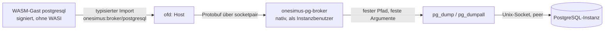

# Planung: PostgreSQL Phase 2 – signierte Binärteile, Broker, Plugin

Stand: 18.11.2026. Status: **Entwurf zur Freigabe.**

Setzt [Phase 1](PLUGIN-PHASE1.md) voraus (abgenommen im Ende-zu-Ende-Lauf) und
den [PostgreSQL-Plan](POSTGRESQL-PLUGIN.md) mit seinen Entscheidungen: Broker
je Instanz als deren Benutzer, Katalog-Datenbank ausgeschlossen, Klasse
`logical` zuerst.

## Bausteine



## A. Manifest Version 2: Hashes der Binärteile

```json
{
  "schema_version": 2,
  "...": "Felder wie Version 1",
  "native": {
    "x86_64-linux-gnu":  [{"path": "postgresql/onesimus-pg-broker", "sha256": "…"}],
    "aarch64-linux-gnu": [{"path": "postgresql/onesimus-pg-broker", "sha256": "…"}]
  }
}
```

- Version 1 bleibt gültig (kein Binärteil). Version 2 ohne Eintrag für den
  Triplet des Hosts ist ein Ladefehler, wenn das Plugin einen Broker braucht.
- `path` ist relativ zum Plugin-Verzeichnis, ohne `..`, ohne führendes `/`.
- Ein Manifest für alle Architekturen: Der Build signiert einmal, die
  Debian-Pakete je Architektur tragen dasselbe Bundle und ihren Binärteil.

## B. Broker starten (in `ofd`)

1. Datei öffnen (`O_RDONLY | O_CLOEXEC | O_NOFOLLOW`), `fstat` auf dem
   Deskriptor: reguläre Datei, Eigentümer root, nicht schreibbar für Gruppe
   und Andere; Verzeichnisse darüber wie bei Bundle und Policy.
2. SHA-256 aus dem Deskriptor lesen und mit dem geprüften Manifest vergleichen.
3. `fork`; im Kind: Umgebung leeren, nur ein `socketpair`-Ende als fd 0/1,
   alle anderen Deskriptoren schließen, `PR_SET_NO_NEW_PRIVS`,
   `PR_SET_PDEATHSIG`, Ressourcengrenzen, dann `setgroups`/`setgid`/`setuid`
   auf den Instanzbenutzer (nie root) und `execveat(fd, "", AT_EMPTY_PATH)`.
4. Abbruch des Jobs: SIGTERM, nach Frist SIGKILL; der Broker beendet seine
   `pg_dump`-Kinder (eigene Prozessgruppe).

## C. Instanz und Benutzer ermitteln

Aus `<socket>/.s.PGSQL.<port>.lock` (enthält PID und Datenverzeichnis):
Eigentümer von Socket, Lock-Datei, `<datadir>/postmaster.pid` und des
laufenden Prozesses `/proc/<pid>` müssen übereinstimmen und dürfen nicht root
sein. Sonst Planfehler. Die Hauptversion kommt aus `<datadir>/PG_VERSION`; der
Broker nimmt `/usr/lib/postgresql/<major>/bin/pg_dump`.

## D. Gast ↔ Host: typisierter Import statt Netz

Die WIT-Welt bekommt eine **optionale** Import-Schnittstelle
`onesimus:broker/postgresql` mit festen Funktionen (`info`, `db-info`,
`dump-open`, `dump-read`, `dump-close`, `globals-open`), deren Nachrichten in
`proto/postgresql_broker.proto` stehen. Der Host verknüpft diesen Import **nur**,
wenn das Manifest und die Policy `postgresql.read` erlauben; ein anderes Plugin
kann ihn nicht einmal instanziieren. Der Host prüft jede Anfrage (Datenbank in
der freigegebenen Liste, Katalog-Datenbank ausgeschlossen) bevor er sie an den
Broker gibt. Es gibt keine generische Aufruf- oder Byte-Schnittstelle.

## E. Broker `onesimus-pg-broker`

Rust, nativ, im Plugin-Paket. Liest Protobuf-Anfragen von fd 0, antwortet auf
fd 1. Kennt nur diese Operationen; startet `pg_dump`/`pg_dumpall` mit fester
Argumentliste (`-Fc`, `--no-password`, `-h <socketdir>`, `-p <port>`) und
streamt deren Ausgabe in Blöcken. Liest keine Konfiguration und keine
Umgebung außer dem Socket-Pfad, den der Host übergibt.

## F. Gast `postgresql`

`no_std`-Komponente wie `example-tree`. Baut den virtuellen Baum
`/@postgresql/<instanz>/…` aus `info`/`db-info`, liefert `globals.sql` und je
Datenbank `<db>.dump` über `dump-read`, `_info.json` zuletzt.

## G. Paket

`onesimus-plugin-postgresql`, `Architecture: any`, `Multi-Arch: same`:
`/usr/lib/<triplet>/onesimus/plugins/postgresql.pb` und
`/usr/lib/<triplet>/onesimus/plugins/postgresql/onesimus-pg-broker`.

## H. Tests

- Manifest v2: Hash falsch, Pfad mit `..`, fehlender Triplet, v1 weiter gültig.
- Start: ausgetauschte Datei zwischen Prüfung und Start (Deskriptor wird
  gestartet), beschreibbares Verzeichnis, Instanzbenutzer root abgelehnt.
- Import: Plugin ohne `postgresql.read` kann nicht instanziieren.
- Wegwerf-Cluster mit `initdb` im Testverzeichnis (eigener Socket, kein root):
  alle Datenbanken, `SQL_ASCII`, Name mit `-`, neue Datenbank zwischen zwei
  Läufen, `pg_restore` des Ergebnisses ergibt dieselben Daten, Cancel während
  `pg_dump` hinterlässt keinen Prozess.
- Ende-zu-Ende wie Phase 1 gegen `odir` und `bareos-sd`.

## Zur Entscheidung

1. **Typisierter WIT-Import je Broker** (Vorschlag) statt einer allgemeinen
   Aufruf-Schnittstelle mit Capability-Namen.
2. **Datenweg über den Gast** (Vorschlag für Phase 2: einfacher, eine Kopie
   mehr) oder Host streamt Broker-Daten direkt in den SD-Strom (schneller, aber
   der Gast sieht die Daten nicht und kann sie nicht beschreiben/prüfen).
3. **seccomp für den Broker** jetzt oder in einer späteren Phase (Vorschlag:
   später; `NO_NEW_PRIVS`, eigener Benutzer, leere Umgebung sind Pflicht).
