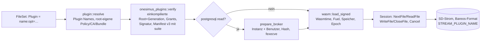

# Übergabe: Stand der Plugin-Arbeit (19.11.2026)

Diese Seite fasst eine längere Sitzung zusammen, damit die Arbeit in diesem
Repository weitergehen kann. Alles liegt auf `development`, **nicht gepusht**.

## Kurz

- **Phase 1** ([Plan](PLUGIN-PHASE1.md)): signierte WASM-Plugins laufen in
  `ofd` – Sicherung in den SD-Strom (Bareos-Format), Restore in Dateien ohne
  Plugin-Code oder online über das Plugin. Echter Lauf gegen `odir` +
  `bareos-sd` 25.1.3 bestanden.
- **Phase 2 PostgreSQL** ([Plan](POSTGRESQL-PHASE2.md), [Grundplan](POSTGRESQL-PLUGIN.md)):
  Manifest v2, Broker-Start aus geprüftem Deskriptor, Instanz-/Benutzer-
  Erkennung, typisierter Import, `onesimus-pg-broker`, Gast `postgresql`.
  Echter Lauf gegen den lokalen PostgreSQL-17-Cluster (Broker als `postgres`)
  bestanden.
- **Signier-Infrastruktur** ([Plan](SIGNIER-INFRASTRUKTUR.md)): freigegeben,
  Code-Änderungen 1–5 umgesetzt (einkompilierte Vertrauensbasis, Grants im
  Zertifikat, RSA-PSS 4096, Manifest Schema 3 mit `suite`, `sign-component
  prepare`/`assemble`, `--check-plugin` für Broker-Plugins). Offen: Schritte
  mit TPM am echten System.
- **Nächstes:** Debian-Paket `ofd-plugin-postgresql` (Schritt G).

## Das Plugin-System im Überblick



| Teil | Datei | Aufgabe |
| --- | --- | --- |
| Vertrag | `proto/filed_plugin.proto`, `proto/postgresql_broker.proto`, `crates/onesimus-plugins/wit/filed-plugin.wit` | Protobuf-Nachrichten; WIT-Welten `plugin` (nur Exporte) und `postgresql-plugin` (+ Broker-Import) |
| Prüfung | `crates/onesimus-plugins/src/lib.rs`, `trust.rs`, `certificate.rs`, `bundle.rs` | Manifest (Schema 3; 1/2 laden nicht mehr), Kette Leaf → Generation → Root, Grants-Erweiterung, Ed25519/RSA-PSS, lokale Policy (nur einschränkend), Widerruf |
| Vertrauensbasis | `crates/ofd/build.rs`, `crates/ofd/src/plugin/trust.rs` | `ONESIMUS_PLUGIN_CA` (root.pem, generation.pem, revoked.json) einkompiliert; ohne sie lädt kein Plugin |
| Signieren | `crates/onesimus-plugins/src/signing.rs`, `examples/sign-component.rs` | `prepare` (Manifest) und `assemble` (Bundle, prüft Signatur), ohne privaten Schlüssel |
| WASM-Host | `crates/onesimus-plugins/src/wasm.rs`, `executor.rs` | Laden geprüfter Bytes, Grenzen, Worker je Instanz, außerbandiges Cancel, Broker-Import nur mit Capability |
| FD-Anbindung | `crates/ofd/src/plugin.rs` | Plugin-Zeile, Rechteprüfung (StrictModes), `Session`, `prepare_broker` |
| Sicherung | `crates/ofd/src/backup.rs` (`save_plugin`, `plugin_ff`, `plugin_path`) | Dateien in den SD-Strom, Pfade absolut ohne `..`, Zeile maskiert auf dem Volume |
| Wiederherstellung | `crates/ofd/src/restore.rs` | in Dateien (ohne Plugin) oder online (`restore_mode=online`), Verzeichnis-Attribute zuletzt |
| Broker-Start | `crates/ofd/src/broker.rs` | Hash auf offenem Deskriptor, Benutzerwechsel, `fexecve`, Prozessgruppe |
| PostgreSQL | `crates/ofd/src/pg_instance.rs`, `pg_port.rs`, `crates/onesimus-pg-broker/`, `plugins/postgresql/` | Instanz/Benutzer, Prüfung jeder Broker-Anfrage, Broker, Gast |
| Gäste | `plugins/guest-runtime/`, `plugins/example-tree/` | `no_std`-Laufzeit, Testgast |
| Testhilfen | `crates/onesimus-plugins/src/testca.rs` (Feature `test-ca`), `crates/ofd/src/plugin/testkit.rs` | Test-Hierarchie Ed25519-Root → Generation → RSA-4096-Leaf mit Grants; signierte Testbundles (Schema 3) |
| Konfiguration | FD: `Plugin Directory` (Vorgabe Multiarch-Pfad), `Plugin Names`, `Plugin Policy` | siehe `docs/wiki/file-daemon.md` |

**Sicherheitsregeln (verbindlich):**
- Nur signierte Plugins; kein Entwickler- oder Testmodus ohne Signatur.
- Policy, ihre CA-Dateien, Plugin-Verzeichnis, Bundle und Binärteile müssen
  root gehören und dürfen für Gruppe/Andere nicht schreibbar sein, bis `/`.
- Signatur, Policy und Widerruf werden bei jedem Job neu geprüft; geprüfte
  Bytes werden ausgeführt, die Datei wird nicht erneut geöffnet.
- Der Gast hat keine WASI-, Netz-, Datei- oder Prozess-Importe; einzig ein
  typisierter Broker-Import, wenn Manifest und Policy die Capability gewähren.
- Der Host prüft jede Broker-Anfrage; Broker laufen nie als root.
- Restore in Dateien führt keinen Plugin-Code aus und funktioniert auch,
  wenn das Plugin fehlt, gesperrt oder abgelaufen ist.
- Passwörter aus Plugin-Zeilen erscheinen nie auf dem Volume, im Joblog oder
  im Katalog (maskiert); beim Online-Restore kommen sie nur aus dem Restore-Job.

## Entscheidungen des Nutzers

| Thema | Entscheidung |
| --- | --- |
| Plugins | signiert (Rust/WASM); Signatur ist Ausführungsbedingung, kein unsignierter Pfad |
| Verteilung | ein Debian-Paket je Plugin (`ofd-plugin-<name>`), `Architecture: any`, Multiarch-Pfad `/usr/lib/<triplet>/onesimus/plugins/` |
| PostgreSQL-Broker | je Instanz als der Benutzer, unter dem die Instanz läuft |
| Katalog-DB | nie sichern; `odir` sendet `catalog_database=` mit |
| Reihenfolge | Phase 1 gemeinsam, dann PostgreSQL |
| Phase 2 | typisierter WIT-Import je Broker; Daten über den Gast; seccomp später |
| Binärteile | Hash je Triplet im signierten Manifest, `fexecve` auf dem geprüften Deskriptor |
| Vertrauensbasis | Root und Generation in `ofd` einkompiliert, Grants im Signierzertifikat, lokale Policy nur einschränkend |
| Signierung | CA Ed25519 offline, je Generation ein Zwischenzertifikat, Signierschlüssel RSA 4096 im TPM, Zertifikate 3 Jahre, Suite-Bindung mit hartem Schnitt |
| WAL / `physical` | noch nicht entschieden (Fragen in POSTGRESQL-PLUGIN.md) |

## Commits dieser Arbeit (ältester zuerst)

Pläne: `e076c84`, `dde3007`, `3f98f34`, `94300bb`, `a831564`, `8117e1f`.
Phase 1: `6f5309c` (Proto: Submodul-Branch `plugin-phase1`), `9d6618e`,
`2ef8542`, `564f429`, `b8ea690`, `6a9d2f9`, `d12f375`, `0a0c1d7`, `f2cdb54`,
`4cad5b8`, `5dfb483` (odir), `38276b8`, `b46b10b` (odir), `998d7d7`.
Phase 2: `77e2c8e`, `1a8809e`, `a4046a8`, `1876efa` (Proto `2d0cc93`),
`6838be1`, `5cbccbd`, `2b21768`, `d7bb6c5`, `963a831`.

**Vor dem Push:** zuerst `proto` (Branch `plugin-phase1` mit `226f5cc` und
`2d0cc93`), sonst zeigt der Submodul-Verweis ins Leere.

## Bauen und testen

```sh
cargo test -p ofd -p odir -p onesimus-plugins -p onesimus-pg-broker
# Ende-zu-Ende (ignored): Gäste und Broker vorher bauen
(cd plugins/example-tree && CARGO_TARGET_DIR=../../target/plugins cargo +1.99.1 build --release --target wasm32-wasip2)
(cd plugins/postgresql   && CARGO_TARGET_DIR=../../target/plugins cargo +1.99.1 build --release --target wasm32-wasip2)
cargo build -p onesimus-pg-broker
cargo test -p ofd -- --include-ignored
# ofd mit eingebauter Vertrauensbasis (sonst lädt es kein Plugin):
ONESIMUS_PLUGIN_CA=/pfad/zu/plugin-ca-g1 cargo build --release -p ofd
```

- `cargo +1.99.1`: Auf WS-JOERG installiert `rustup` Ziele in die Toolchain
  `1.99.1`, der Standard-`rustc` läuft aus einem separaten Verzeichnis `stable`
  ohne Wasm-Ziele. Bereinigen: Toolchain `stable` neu installieren.
- Gäste sind `no_std` (`plugins/guest-runtime`): Rusts std zieht WASI-Importe,
  die der Host ablehnt.
- PostgreSQL-Tests starten einen Wegwerf-Cluster mit `initdb` (eigener Socket,
  kein TCP, kein root).
- Stand der Tests (19.11.2026, nach der Signier-Infrastruktur): `ofd` 75 + 1 (inkl. ignored),
  `odir` 677 (+ 5 ignored), `onesimus-plugins` 43, Broker 2 – alle grün.

## Offen

| Punkt | Wo |
| --- | --- |
| Signier-Infrastruktur: Schlüssel erzeugen, TPM-Import, erstes echtes Signieren (Anleitung „Ablauf“); offene Vorschläge freigeben | SIGNIER-INFRASTRUKTUR.md |
| Debian-Paket `ofd-plugin-postgresql`, Keyring-Paket | POSTGRESQL-PHASE2.md G |
| Online-Restore PostgreSQL (in neue Datenbank) | POSTGRESQL-PLUGIN.md Phase 3 |
| Klasse `physical` (WAL über `pg_receivewal`) | POSTGRESQL-PLUGIN.md, offene Fragen |
| Job-Bericht zeigt „Software Compression: None“ trotz LZ4 | PLUGIN-PHASE1.md |
| OpenLDAP-, Docker-, Podman-Plugin | jeweilige Pläne |

## Betrieb (Bareos-Umgebung, Befunde vom 18.11.)

- FileSet `NextCloud-fs`: DB-Dump-Verzeichnis aufgenommen, Ausschlüsse
  korrigiert (vom Nutzer auf PDC umgesetzt). Testlauf aller Jobs am Ende.
- **Offen:** Datenbank-Passwörter stehen im Klartext in den `RunScript`-Zeilen
  der Jobs `BackupNextcloud`, `BackupPassbolt`, `BackupEleLa` und damit in
  Joblogs; Passwörter ändern, sobald die Dumps ohne Passwort laufen.
- **Offen:** keine Kopie außer Haus (alles auf `PDC-sd`); Volumes `CLOUD-0004`,
  `CLOUD-0017` im Status `Error`.
- **Offen:** Datenbanken `multigpt`/`multi-gpt` auf PDC werden von keinem Job
  gesichert. Übergang bis zum Plugin-Paket: `pg-dump-all.sh` (Entwurf in der
  Sitzung; als `postgres` über den Socket, ohne Passwort).
- Auf PDC war `dump-database.sh` bereits gepatcht (Passwort optional über
  `.pgpass`); die Nutzung als `postgres` per Socket ist der bessere Weg.
