# Architekturvergleich: Bareos Director (C++) und Onesimus Director (Rust)

Stand: 17.10.2026. Für Entwickler und Architekten des Onesimus-Projekts.

Verglichen werden:

- **Original:** Bareos Director `bareos-dir 25.1.2~pre43.18be77e68`, Quellstand `18be77e6`
  (Checkout `/tmp/bareos-director-reference-18be77e6`, Verzeichnisse `core/src/dird`, `lib`,
  `cats`, `console`, `stored`, `filed`, `include`, `findlib`). Pfade unten relativ zu `core/src/`.
- **Onesimus:** dieses Repository, vor allem
  [`crates/onesimus-dird`](../../crates/onesimus-dird/src/main.rs) und die Crates
  [`bareos-bnet`](../../crates/bareos-bnet/src/lib.rs),
  [`bareos-config`](../../crates/bareos-config/src/lib.rs),
  [`bareos-orm`](../../crates/bareos-orm/src/lib.rs),
  [`bareos-catalog`](../../crates/bareos-catalog/src/lib.rs),
  [`onesimus-proto-rs`](../../crates/onesimus-proto-rs/src/lib.rs),
  [`oconsole`](../../crates/oconsole/src/main.rs),
  [`bareos-filed`](../../crates/bareos-filed/src/main.rs).

Jede Aussage nennt Datei und Funktion. Wo eine Aussage auf einer Lesart des Codes
beruht und nicht durch einen Test oder Paritätsfall belegt ist, steht das dabei
(„nicht geprüft“). Die Entscheidungen und Abweichungen tragen die Nummern aus dem
[Kompatibilitätslog](../COMPATIBILITY-LOG.md) (C-…) und dem [Stubs-Backlog](../STUBS.md) (S-…).

## Inhalt

1. [Überblick: Prozesse, Threads, Laufzeitmodell](#1-überblick-prozesse-threads-laufzeitmodell)
2. [Konfiguration](#2-konfiguration)
3. [Konsole und Netzwerk](#3-konsole-und-netzwerk)
4. [Job-Lebenszyklus](#4-job-lebenszyklus)
5. [Katalog](#5-katalog)
6. [Meldungen und Logging](#6-meldungen-und-logging)
7. [Scheduler, Watchdog, Limits](#7-scheduler-watchdog-limits)
8. [Sicherheitsmodell](#8-sicherheitsmodell)
9. [Erweiterbarkeit](#9-erweiterbarkeit)
10. [Unterschiede, Entscheidungen, Lücken, Stärken und Risiken](#10-unterschiede-entscheidungen-lücken-stärken-und-risiken)

---

## 1. Überblick: Prozesse, Threads, Laufzeitmodell

### Kurzfassung

| | Bareos (C++) | Onesimus (Rust) |
|---|---|---|
| Prozesse | ein Prozess `bareos-dir` | ein Director-Prozess `onesimus-dird` **plus ein geforkter Prozess je laufendem Job** mit Daemon-Kontakt (`job:<id>`) |
| Jobs | ein POSIX-Thread je laufendem Job aus `jobq.cc` (`jobq_server`, höchstens `MaxConcurrentJobs` Threads) | Warteschlange im `JobManager` (`job_manager.rs`), Ausführung im geforkten Worker (`job_worker.rs::spawn_job_worker`); Copy/Migrate-Steuerjobs und Consolidate laufen im Director selbst (`internal_jobs.rs`) |
| Jobzustand | `JobControlRecord` (JCR, `lib/jcr.h`, `dird/director_jcr_impl.h`), globale JCR-Kette | `DirJob` + `JcrState` im `JobManager` (Director), `JobParams` (serialisiert in den Worker) |
| Konsolen | ein Thread je Verbindung aus `lib/thread_list.cc` (`BnetThreadServerTcp`, `lib/bnet_server_tcp.cc`) | ein benannter Thread je Verbindung `dir:session:<n>` (`accept.rs::accept_loop`) |
| Katalog | eine DB-Verbindung je JCR/UaContext (`dird/get_database_connection.cc`, Pooling `cats/sql_pooling.cc`) | ein Katalog-Thread `dir:catalog` mit tokio-Runtime und sqlx-Pool (max. 8), Anfragen über einen `flume`-Kanal (`catalog_worker.rs`) |
| Scheduler | läuft im **Hauptthread** (`dird.cc:main` → `Scheduler::GetMainScheduler().Run()`) | eigener Thread `dir:scheduler` (`scheduler.rs::scheduler_loop`); Hauptthread wartet nur auf Signale |
| Watchdog | `lib/watchdog.cc` (Timer-Thread mit Callbacks, u. a. `JobMonitorWatchdog`, `job.cc:717`) | `dir:watchdog` (`watchdog.rs`: Zombies, Scheduler-Herzschlag); Joblimits in `job_manager/limits.rs`, aufgerufen von `dir:job-monitor` |
| Async | keine; blockierende Sockets, `pthread_cond_timedwait` | tokio nur für gRPC (`dir:grpc`) und Katalog (`dir:catalog`); Kern synchron mit `std::thread`, `crossbeam`/`flume`-Kanälen und `Mutex`/`RwLock` (`main.rs`, Modulkommentar „tokio only for gRPC“) |
| Statistik | `dird/stats.cc` `StartStatisticsThread` | kein Gegenstück gefunden |

### Prozess- und Threadmodell Bareos (C++)

Quelle: `dird/dird.cc:main` (Zeile 136 ff.): `ParseConfigOrExit`, `daemon_start`,
`LoadDirPlugins`, `CheckCatalog`, `InitConsoleMsg`, `StartWatchdog`, `InitJobServer`,
`StartStatisticsThread`, `StartSocketServer`, dann `Scheduler::Run()` im Hauptthread.

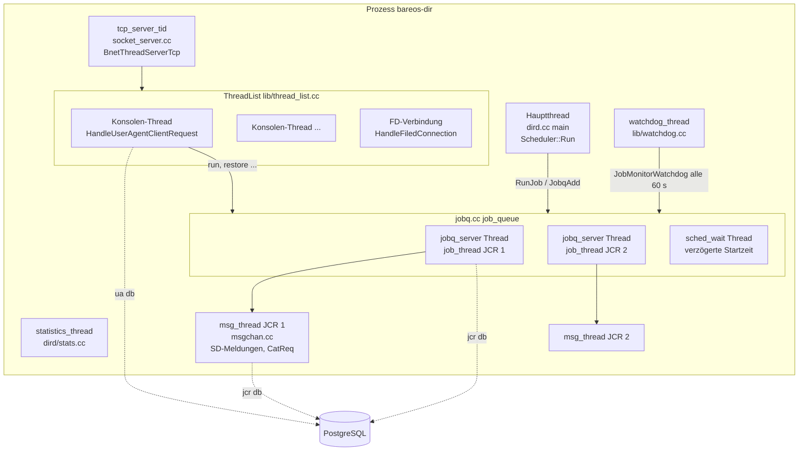

Alle Jobs, Konsolen und der Scheduler teilen einen Adressraum. Ein Speicherfehler in
einem Job-Thread beendet den gesamten Director (Signalhandler `InitStackDump`,
`lib/signal.cc`).

### Prozess- und Threadmodell Onesimus (Rust)

Quelle: [`main.rs`](../../crates/onesimus-dird/src/main.rs) (`main`, `spawn_named_threads`),
[`job_worker.rs`](../../crates/onesimus-dird/src/job_worker.rs) (`spawn_job_worker`),
[`catalog_worker.rs`](../../crates/onesimus-dird/src/catalog_worker.rs) (`spawn_catalog_worker`).

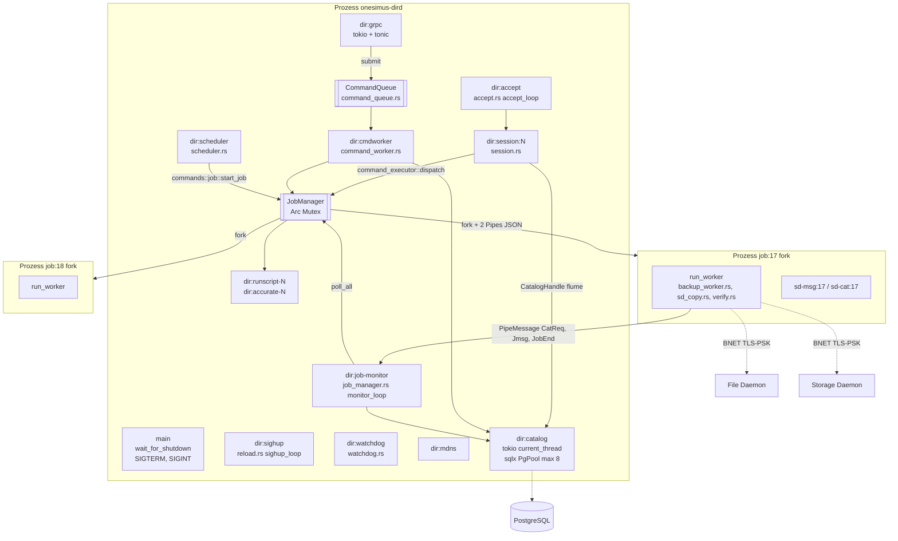

Kernpunkte:

- **Fork je Job.** `JobManager::start_ready_jobs` (`job_manager.rs`) ruft den `Spawner`
  (Standard `job_worker::spawn_job_worker`), der mit `nix::unistd::fork` einen Kindprozess
  anlegt, im Kind alle Dateideskriptoren 3…1023 außer den zwei Pipes schließt, den
  Prozessnamen `job:<id>` setzt (`prctl(PR_SET_NAME)`) und `run_worker` ausführt.
  Kommunikation: zwei Pipes, eine JSON-Zeile je `PipeMessage` (`State`, `Status`,
  `CatReq`/`CatResp`, `UpdCat`, `Jmsg`, `JobEnd`, `RunScripts`/`RunScriptsDone`,
  `AccurateRequest`, `QuotaCheck`, `Verify` …). Abbruch per `SIGTERM`
  (`JobHandle::cancel`); `pause`/`resume` (`SIGUSR1`/`SIGUSR2`) sind vorhanden, haben aber
  keinen Aufrufer (`JobManager::pause_job`/`resume_job`, Suche ohne Treffer).
- **Der Worker hat keine Katalogverbindung.** Katalogwünsche des Storage Daemons laufen
  als `PipeMessage::CatReq`/`UpdCat` zum Director und werden dort von `dir:job-monitor`
  (`JobManager::poll_all` → `catreq.rs`) über den Katalog-Thread beantwortet.
- **Ein Lock für alle Jobs.** `JobManager` liegt hinter `Arc<std::sync::Mutex<…>>`.
  `monitor_loop` nimmt die Sperre für jeden Durchlauf (`poll_all`), pollt alle Pipes und
  schläft 100 µs (Jobs aktiv) bzw. 50 ms (leer). Director-eigene Jobs
  (`run_internal_job`: Copy/Migrate-Auswahl, Consolidate) laufen nach Lesart des Codes
  innerhalb dieses Durchlaufs (nicht gemessen). RunScripts laufen auf eigenen Threads
  `dir:runscript-<id>`, damit Konsolenbefehle die Sperre nicht verklemmen (Hinweis S-07).
- **Katalog seriell.** `spawn_catalog_worker` bedient den Kanal in einer Schleife
  `while let Ok((req, resp_tx)) = rx.recv_async().await` und wartet jede Anfrage ab, bevor
  es die nächste nimmt. Nur `CatalogRequest::Dedicated` (reservierte Verbindung, z. B. BVFS
  mit `BEGIN/LOCK/COMMIT`) läuft parallel per `spawn_local`. Der Pool hat 8 Verbindungen,
  genutzt wird für normale Anfragen also praktisch eine zur Zeit.
- **gRPC seriell.** Jede gRPC-Anfrage (Dienst `Director` und `DirectorApi`) wird über
  `CommandQueue::submit` an den einen Thread `dir:cmdworker` übergeben
  (`grpc/service.rs::run_command`, `command_worker.rs::command_worker_loop`). BNET-Konsolen
  führen ihre Befehle dagegen im eigenen Sitzungsthread aus (`session.rs`).

### Komponenten Bareos (C++)

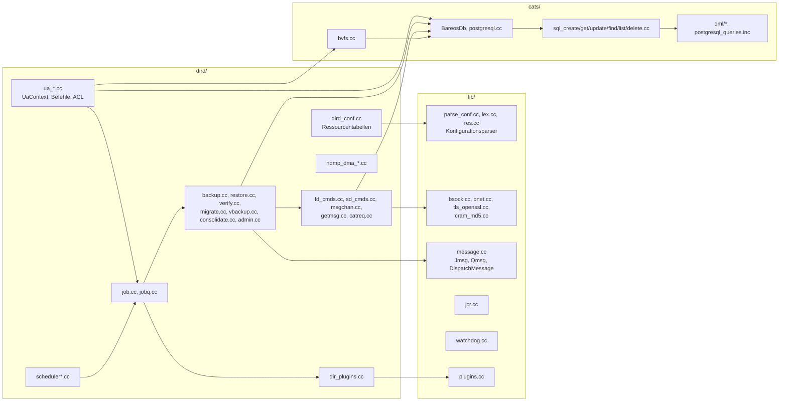

### Komponenten Onesimus (Rust)

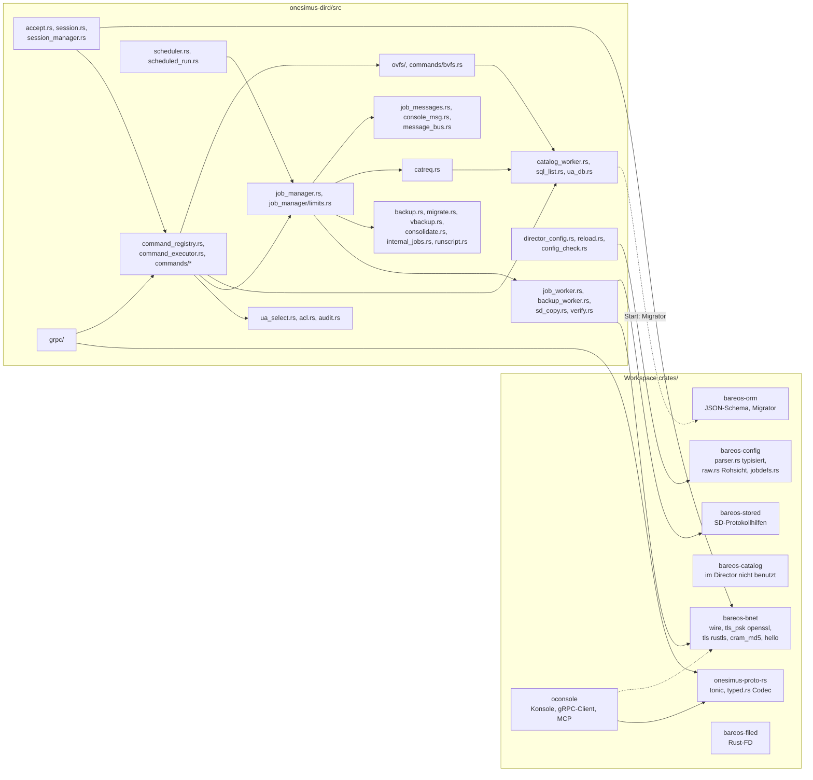

`bareos-catalog` ist als Abhängigkeit eingetragen, im Code von `onesimus-dird` gibt es aber
keinen Aufruf `bareos_catalog::` (Suche vom 17.10.2026). Von `bareos-orm` nutzt der Director
nur den `Migrator` beim Start (`main.rs`).

### Laufzeitmodell im Vergleich

| Aspekt | C++ | Rust | Folge |
|---|---|---|---|
| Gemeinsamer Zustand | globale Variablen (`me`, `my_config`, JCR-Kette), Sperren `LockJobs`, `LockJcrChain`, `ResLocker` | `Arc<RwLock<DirectorConfig>>` (`SharedConfig`), `Arc<Mutex<JobManager>>`, `SessionManager`, statische `Mutex`e (z. B. `audit.rs::FILES`, `catreq::RUNNING_JOBIDS`) | Rust erzwingt Synchronisation zur Übersetzungszeit; Engpass ist das eine `JobManager`-Lock |
| Job-Engine | `job_thread` (`job.cc:415`) ruft je Typ `Do…`/`…Cleanup` im Job-Thread | Init im Director (`backup.rs`, `verify.rs::run_verify` …), Daemon-Teil im Worker, Ende im Director (`JobManager`) | Ein Job ist auf zwei Prozesse verteilt; Zustand wird über Pipes gespiegelt |
| Speichersicherheit | manuelle Speicherverwaltung, `POOLMEM`, `BStringList` | Safe Rust; `unsafe` an Systemgrenzen (`fork`, `libc::kill`, `from_raw_fd`, `prctl`) | weniger Speicherfehlerklassen; `fork` in einem Mehrthread-Prozess bleibt heikel (siehe Risiken) |
| Shutdown | `TerminateDird` (Signalhandler): Socket-Server, Watchdog, Pool, Plugins, Statusdatei, Scheduler, Jobqueue | `SHUTDOWN` (`AtomicBool`) + `join` aller benannten Threads (`main.rs`) | Rust schreibt keine Statusdatei (`WriteStateFile`); nicht weiter geprüft |

---

## 2. Konfiguration

### Parser und Ressourcenmodell

| | C++ | Rust |
|---|---|---|
| Lexer | `lib/lex.cc` | `bareos-config/src/raw.rs` (Lexer-Semantik von `lex.cc`: `#`, `;`, Escapes, verkettete Strings) |
| Parser | `ConfigurationParser::ParseConfig` (`lib/parse_conf.cc:162`), Zustandsmaschine `lib/parse_conf_state_machine.cc`, **zwei Durchläufe** (Pass 1 legt an, Pass 2 löst Verweise) | `bareos-config/src/parser.rs` (`parse_config_dir`, `parse_config_file`, `parse_config`) → typisierte Structs (`resources.rs`); daneben die **Rohsicht** `raw.rs` (alle Direktiven mit Tokens in Original-Reihenfolge) |
| Ressourcen-Schema | `ResourceItem`-Tabellen in `dird/dird_conf.cc` (`dir_items` Zeile 119, `job_items` Zeile 284 …) mit Store-Funktionen und Default-Werten | doppelt: Felder in `bareos-config/src/resources.rs` und eine aus den C++-Tabellen nachgebaute Liste in `commands/show_items.rs` (Name, Typ, Default, Aliase) für `show`, `configure`, `.defaults` |
| JobDefs | `PopulateJobdefaults` in `CheckResources` (`dird/reload.cc:36`) | `bareos-config/src/jobdefs.rs` (C-041) |
| Laufzeit-Container | `my_config` mit `BackupCurrentConfiguration`/`RestoreConfiguration`; alte Konfiguration bleibt für laufende Jobs am Leben (`SetNext`) | `DirectorConfig` (`director_config.rs`) mit typisierten Vektoren, `raw` und Flag `reloaded`; geteilt als `Arc<RwLock<…>>` |
| Ausgabe | `PrintConfig` je Ressource (`lib/res.cc`) | `commands/show.rs` aus `raw` + `show_items.rs` |

Das Rust-Modell hält also zwei Sichten derselben Datei: eine typisierte für die Logik und
eine Rohsicht für Befehle, die die Konfiguration byte-gleich wiedergeben müssen (`show`,
`configure export`). Das ist bewusst (Modulkommentar `raw.rs`), erzeugt aber eine
Konsistenzpflicht zwischen `resources.rs`, `raw.rs` und `show_items.rs`.

### Reload, `omit_defaults`, Konfigurationsprüfung

- **C++** `DoReloadConfig` (`dird/reload.cc:179`): Statistik-Thread stoppen, `LockJobs`,
  `ResLocker`, `DbSqlPoolFlush`, Sicherung der aktuellen Konfiguration, `ParseConfig`,
  `CheckResources`, `CheckCatalog(UPDATE_CATALOG)`, `InitializeSqlPooling`; bei Erfolg
  `ClearQueue` des Schedulers, sonst `RestoreConfiguration`. Das erste `CheckResources`
  setzt `omit_defaults_`; danach druckt `show` ungesetzte Werte anders (C-057, C-064, C-065).
- **Rust** `reload.rs::reload_config`: neu laden (`DirectorConfig::load`), dann
  `config_check::check` (Pass-1/Pass-2-Fehler und `CheckResources`-Regeln, C-057), dann
  `check_catalog::check_connections` je Catalog-Ressource (C-075), erst dann Austausch unter
  dem Schreib-Lock; neue Client/Storage-Sätze per `ensure_basic_records`. `reloaded = true`
  bildet `omit_defaults_` nach. SIGHUP kommt nur beim Thread `dir:sighup` an (`block_sighup`
  in `main` vor allen Threads).
- **Prüfung beim Start:** `-t` (`config_test.rs`, S-29) prüft wie `bareos-dir -t` und endet
  mit denselben Exit-Codes. Der **normale Start prüft nicht** wie `-t`, und Lexer-Diagnosen
  mit Zeile/Spalte fehlen, weil die Rohsicht keine Tokenpositionen hält (offen, C-057,
  [BACKLOG](../BACKLOG.md)).
- **Fehlende Konfigurationsdatei:** `main.rs` startet dann mit einer eingebauten Minimal-
  konfiguration (`Director { Name = bareos-dir … Password = default }`) und warnt nur. Das
  Original bricht ab (`ParseConfigOrExit`). Siehe Risiken.

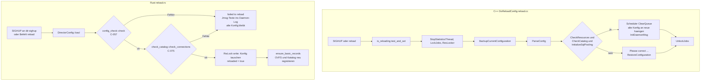

Unterschied mit Folgen: Das Original sperrt während des Reloads alle Jobs (`LockJobs`) und
leert die Scheduler-Warteschlange. Onesimus tauscht nur die geteilte Konfiguration; ein
bereits geforkter Worker arbeitet mit seiner Kopie (`JobParams`) weiter, der Director-Teil
desselben Jobs liest nach dem Tausch die neue Konfiguration. Ob das in Randfällen
(Ressource eines laufenden Jobs gelöscht) zu Abweichungen führt, ist nicht geprüft.

---

## 3. Konsole und Netzwerk

### BNET, TLS-PSK, CRAM-MD5

| Schicht | C++ | Rust |
|---|---|---|
| Rahmen `[i32 BE Länge][Nutzdaten]`, negative Länge = Signal | `lib/bsock.cc`, `lib/bnet.cc`, `lib/bnet_protocol_signals.h` | `bareos-bnet/src/wire.rs`, `signal.rs`, `stream.rs` |
| TLS-PSK (Standard seit 18.2) | `lib/tls_openssl.cc`, `TryTlsHandshakeAsAServer` (`lib/try_tls_handshake_as_a_server.cc`) | `bareos-bnet/src/tls_psk.rs` (OpenSSL, weil rustls kein PSK kann); PSK-Identität wählt den Schlüssel (`accept.rs::psk_for_identity`) |
| TLS mit Zertifikat | Ressourcen-Direktiven `TlsCertificate` … (`tls_conf.cc`) | `bareos-bnet/src/tls.rs` (rustls); Zertifikat nur über Kommandozeile `--tls-cert/--tls-key`, `verify_peer: false` (`main.rs`) |
| Erkennung TLS/Klartext | `TryTlsHandshakeAsAServer` | erstes Byte `0x16` (ClientHello) per Peek (`accept.rs::handle_connection`) |
| Hello und Routing | `HandleConnectionRequest` (`dird/socket_server.cc:70`): FD-Hello → `HandleFiledConnection`, sonst `HandleUserAgentClientRequest` | `bareos-bnet/src/hello.rs::parse_hello` → `Hello::DefaultConsole`/`NamedConsole`/`FileDaemon` (`accept.rs::handle_hello`) |
| CRAM-MD5 | `lib/cram_md5.cc` | `bareos-bnet/src/cram_md5.rs` |
| Konsolen-Authentisierung | `dird/authenticate_console.cc` (`ConsoleAuthenticatorBefore_18_2`/`From_18_2`, PAM) | `accept.rs` + `session.rs` (Versionswahl aus dem Hello wie `CreateConsoleAuthenticator`); **kein PAM** |
| Verbindungsgrenze | `MaximumConsoleConnections` (Standard 20) über `ConsoleConnectionLease` (`authenticate_console.cc:398`) | keine Grenze gefunden (nur in `show_items.rs` als Direktive bekannt) |
| Client-initiierte FD-Verbindung | `HandleFiledConnection` hält die Verbindung im `connection_pool` für spätere Jobs | `handle_hello` registriert nur Name und Protokollversion (`SessionManager::add_fd_connection`); Nutzung für Jobs nicht gefunden (S-13 nennt client-initiierte Verbindungen für den eigenen FD als offen) |

### Konsolenbefehl: UaContext gegen session.rs

- **C++:** `HandleUserAgentClientRequest` (`dird/ua_server.cc:85`) erzeugt eine Control-JCR
  (`new_control_jcr("-Console-")`) und einen `UaContext` (`dird/ua.h`), liest Zeilen und ruft
  `Do_a_command` (`dird/ua_cmds.cc:540`), das in der Tabelle `commands[]`
  (`ua_cmds.cc:218`) nachschlägt, die Befehls-ACL prüft und den Handler aufruft. Dialoge
  (`GetCmd`, `DoPrompt`) laufen direkt auf dem Socket (`ua_input.cc`, `ua_select.cc`).
  Ausgabeformate: `OutputFormatter` (`lib/output_formatter.cc`), API-Modi über `.api`.
- **Rust:** `session.rs::handle_console_session_with` liest Zeilen, baut eine `CommandAst`
  (`parse_cli_command`), dann `command_executor::dispatch` → `command_registry::dispatch_registry`
  (`resolve_permitted` prüft Befehl und ACL, sonst „… is an invalid command.“). Die Hilfe- und
  Usage-Texte stammen aus `ua_commands_table.rs`, generiert aus `ua_cmds.cc commands[]`.
  Dialoge: Handler bleiben synchrone Funktionen; `ua_select::with_console` hängt die BNET-
  Verbindung für die Dauer eines Befehls an, ohne Konsole (gRPC, RunScripts) gilt Batch-
  Verhalten wie `ua->batch` (`ua_select.rs`, Modulkommentar).
- **API-Modi:** `ApiMode::Human` (0), `Api` (1, 2) und `Json` (`command_executor.rs`);
  Signale `BNET_ERROR_MSG`/`WARNING_MSG`/`INFO_MSG` vor Meldungen in API-Modi (`session.rs`,
  wie `UaContext::vSendMsg`); JSON-Hülle `json_output.rs::envelope`; Tabellen wie
  `BareosDb::ListResult` in `sql_list.rs`.

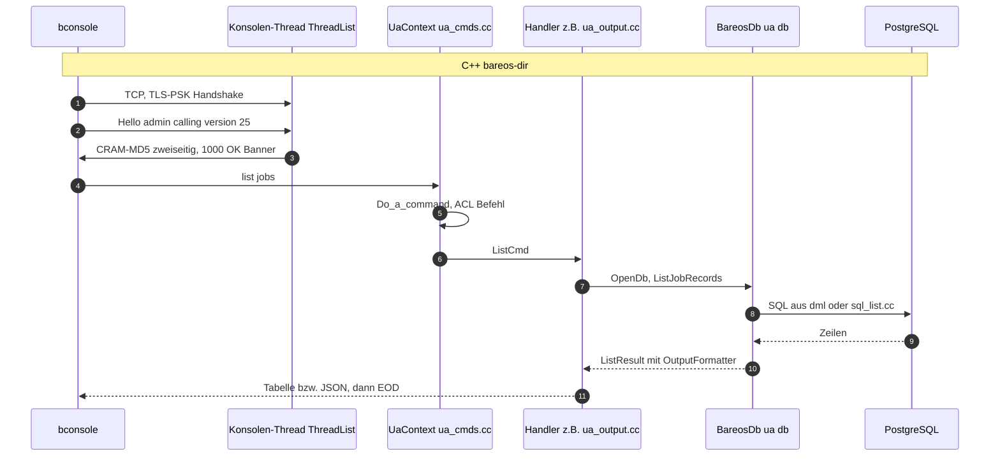

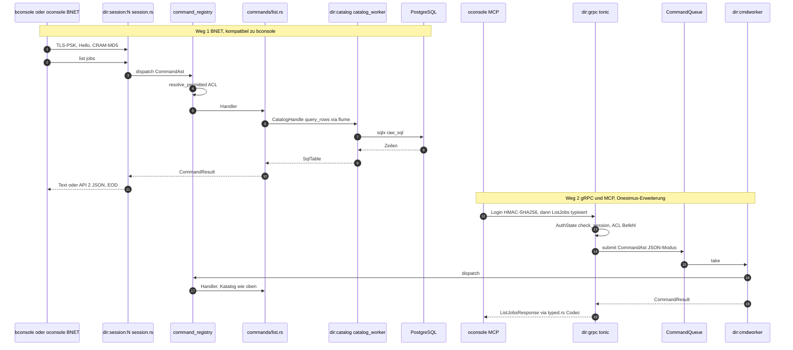

### gRPC und MCP (Onesimus-Erweiterungen)

- **Dienste:** `onesimus.director.Director` (`ExecuteCommand`, Sitzungen, Ereignisse;
  `grpc/service.rs`) und `onesimus.director.api.DirectorApi` (eine RPC je Befehl/Unterbefehl;
  `grpc/api.rs`). Proto-Dateien im Submodul `proto` (Repository onesimus-proto), Rust-Typen
  in `onesimus-proto-rs` (`build.rs`, `typed.rs`). Details: [grpc-api.md](grpc-api.md).
- **Kein zweiter Logikpfad:** Eine typisierte RPC baut eine Konsolenzeile, die durch dieselbe
  Queue, Registry und ACL läuft, im API-2-JSON-Modus; `onesimus_proto_rs::typed` setzt das
  JSON deskriptorgesteuert in die Antwort-Message um (`grpc/api.rs`, Modulkommentar und
  `call`). Damit erbt gRPC die Parität der Konsole, aber auch deren Textformate als
  Zwischenschicht.
- **Build-Trennung:** Schreib-, Sitzungs- und Restore-RPCs nur mit Cargo-Feature
  `grpc-development` (S-35); im Produktions-Build `UNIMPLEMENTED` über
  `generate_default_stubs(true)` (`onesimus-proto-rs/build.rs`).
- **Transport/Anmeldung:** TLS (rustls, Zertifikat aus Konfiguration oder selbst erzeugt per
  `rcgen`, `grpc/tls.rs`), Login per Challenge/Response (Schlüssel = MD5 des Konsolen-
  Passworts, Beweis = HMAC-SHA256 über eine Nonce), danach Sitzungstoken im Header
  `x-onesimus-session` (`grpc/auth.rs`). Port `Grpc Port` bzw. DirPort + 1000, nur mit
  `Enable Grpc = yes`. Entdeckung per mDNS (`mdns.rs`, `_onesimus-dir._tcp.local.` mit
  Zertifikats-Fingerprint als Hinweis).
- **MCP:** `oconsole --mcp` (stdio oder Streamable HTTP mit Bearer-Token). Werkzeuge rufen
  erst die typisierte RPC, bei `UNIMPLEMENTED` `ExecuteCommand`, ohne gRPC die BNET-Zeile.
  Entscheidung C-087: stdio mit vollem Befehlssatz auch im Produktions-Build, HTTP nur lesend.
  Details: [mcp.md](mcp.md).

Das Original hat keinen gRPC- oder MCP-Zugang zum Director; die Bareos-WebUI und
python-bareos sprechen BNET mit `.api 2`.

---

## 4. Job-Lebenszyklus

### Vom `run` zum laufenden Job

| Schritt | C++ | Rust |
|---|---|---|
| Anfrage | `ua_run.cc` `DoRunCmd`, Scheduler `ExecuteJob` | `commands/job.rs::start_job` (auch Scheduler: `scheduled_run.rs` baut eine bestätigte `run … yes`-Zeile plus `RunOverrides`, C-081) |
| JCR | `new_jcr`, `SetJcrDefaults`, `SetupJob` (`job.cc:139`: DB-Verbindung `GetDatabaseConnection`, Job-Record, typabhängiges Init `DoNativeBackupInit` …) | `JobParams` + `JcrState` (`job_manager.rs`); Init im Director, z. B. `backup.rs` (GetOrCreateClientRecord, FileSet-Record, Since-Zeit), `verify.rs::run_verify`, `migrate.rs`, `vbackup.rs` |
| Duplikate | `AllowDuplicateJob` in `SetupJob` | `job_manager/limits.rs` (C-083) |
| Einreihen | `JobqAdd` (`jobq.cc:200`), bei späterer Startzeit eigener Thread `sched_wait` | `JobManager::enqueue_job_with`; Wartende nach Priorität sortiert (`JobqAdd` nachgebaut) |
| Start | `jobq_server` nimmt aus `ready_jobs`, prüft `AcquireResources` (Client/Job/Storage-Zähler), ruft `job_thread` | `start_ready_jobs`: Priorität, `AllowMixedPriority`, Max Concurrent Jobs von Director/Job/Client/Storage; dann `fork` bzw. `run_internal_job` |
| Ausführung | `job_thread` (`job.cc:415`): RunScripts BeforeJob, `switch` auf `JT_BACKUP`/`JT_VERIFY`/`JT_RESTORE`/… → `Do…`, dann `DoAutoprune`, `…Cleanup` | Worker: `run_worker` verzweigt nach `WorkerJobType` (`backup_worker::run`, `sd_copy::run`, `verify::run_worker`, Restore-FSM); BeforeJob fragt per `PipeMessage::RunScripts` den Director |
| Ende | `…Cleanup` im Job-Thread: `UpdateJobEndRecord`, Bericht, AfterJob, `RescheduleJob` | `JobManager::poll_all` nach `JobEnd`/Prozessende: UpdateJobEnd, Bericht (`job_messages.rs`), AfterJob (`runscript.rs`), Reschedule (`take_reruns`) |

### Jobtypen

| Jobtyp | C++ | Rust | Ort der Daemon-Sitzung |
|---|---|---|---|
| Backup (nativ) | `backup.cc` `DoNativeBackupInit`, `DoNativeBackup` (Zeile 503), `NativeBackupCleanup` | `backup.rs` (Director), `backup_worker.rs` (Worker) | Worker |
| Restore | `restore.cc` `DoNativeRestore` (Zeile 382) | `commands/restore.rs`, `commands/restore_bsr.rs` (Bootstrap), Worker-FSM in `job_worker.rs` | Worker |
| Verify | `verify.cc` `DoVerify` (Zeile 112) | `verify.rs` (`run_verify`, `run_worker`, `event`/`finish` im Director) | Worker; Katalogvergleich im Director |
| Copy/Migrate | `migrate.cc` `DoMigrationInit`, `DoMigration` | Auswahl `internal_jobs.rs`, Arbeitsjob `migrate.rs` + `sd_copy.rs` | Steuerjob im Director, Arbeitsjob im Worker; **nur lokales Replizieren** (SD-SD endet fatal, `migrate.rs`) |
| VirtualFull | `vbackup.cc` `DoNativeVbackup` | `vbackup.rs` + `sd_copy.rs` | Worker; Bootstrap/JobId-Liste beim Einreihen statt beim Start (Abweichung laut Modulkommentar) |
| Consolidate | `consolidate.cc` `DoConsolidate` | `consolidate.rs` | Director |
| Admin | `admin.cc` `do_admin` | Worker ohne Daemon-Kontakt (`WorkerJobType::Admin`) | Worker |
| NDMP | `ndmp_dma_*.cc` | `ndmp.rs`: Zweige der Konsolenbefehle; Sitzung → „NDMP protocol not supported“ (C-050) | — |

### Backup-Ablauf mit Daemons und Katalog

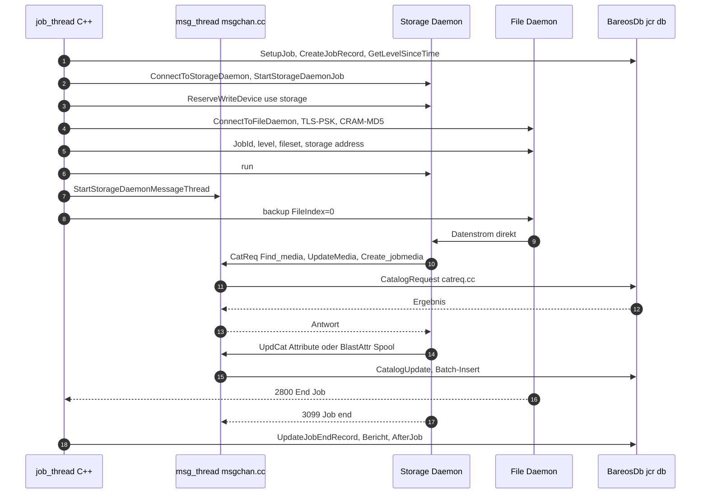

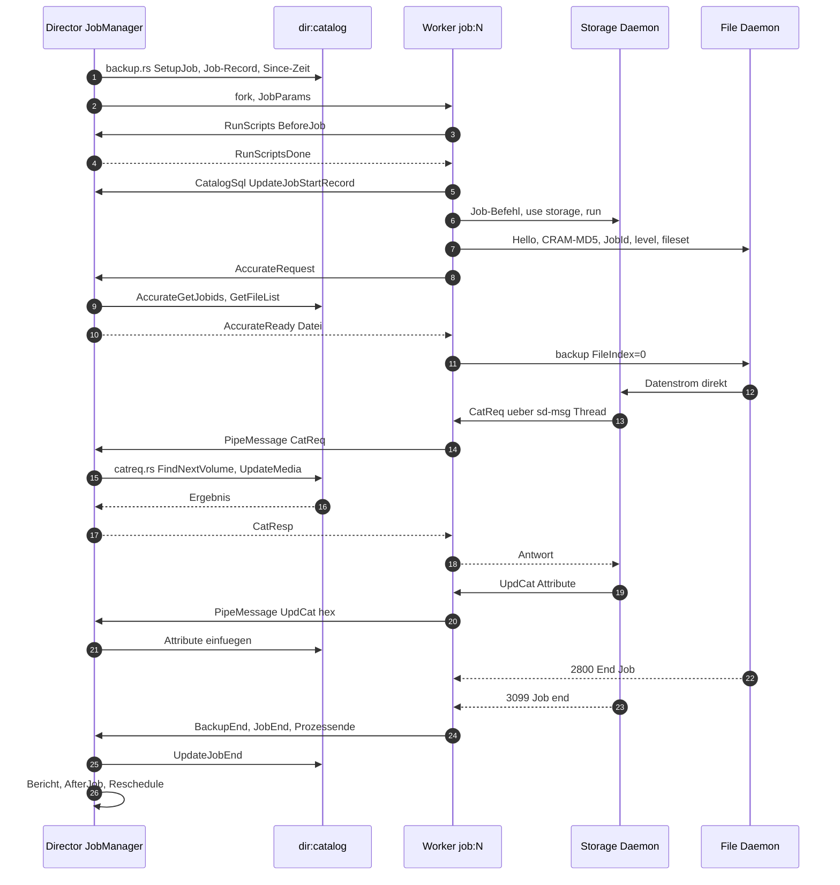

Jede Katalogantwort an den SD macht damit zwei zusätzliche Sprünge (Pipe zum Director,
Kanal zum Katalog-Thread). `monitor_loop` pollt mit 100 µs Pause, solange Jobs laufen.
Messungen dazu gibt es in diesem Repository nur als Skripte (`tests/benchmark_backup.py`,
`tests/stress`), Ergebnisse habe ich nicht ausgewertet.

### Jobzustände

Die Status-Zeichen sind auf beiden Seiten dieselben (`include/job_status.h`; Rust nutzt die
Zeichen in `job_manager.rs`: `is_queued_status`, `status_priority` mit der Regel aus
`lib/jcr.cc`, dass der erste gleichrangige Fehler bleibt und `I` gewinnt).

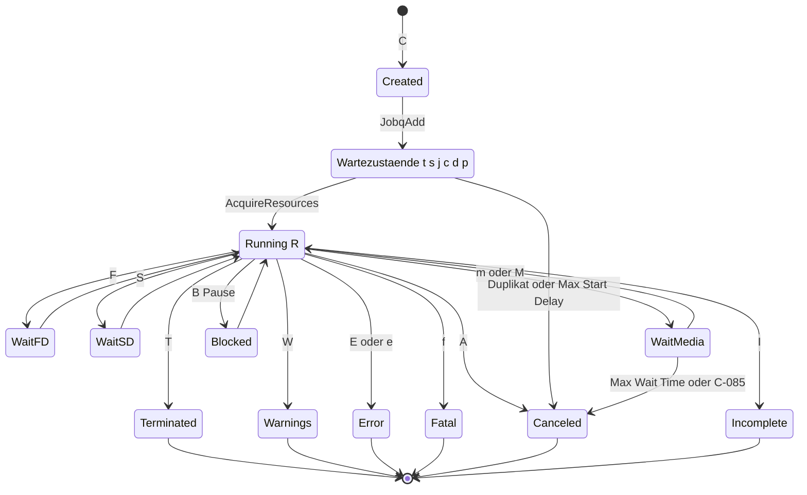

Zusätzlich führt Onesimus zwei eigene Zustandsautomaten, die das Original nicht hat:

- `DirJobPhase` (`job_manager.rs`): `Queued`, `Starting`, `Running`, `Paused`, `Canceling`,
  `WaitingCatReq`, `WaitingMedia`, `WaitingMount`, `Finishing`, `Completed`, `Error`.
- `WorkerState` (`job_worker.rs`, für den generischen Worker-Pfad, v. a. Restore): `Init` →
  `ConnectingFD` → `ConnectingSD` → `SDJobSetup` → `SDUseDevice` → `SDRun` (`SDBootstrap`)
  → `FDJobSetup` → `FDStorage` → `FDSession` → `FDBackup`/`FDRestore` → `Running` →
  `Finishing` → `Completed`, Seitenwege `Paused`, `Canceling`, `Error`.

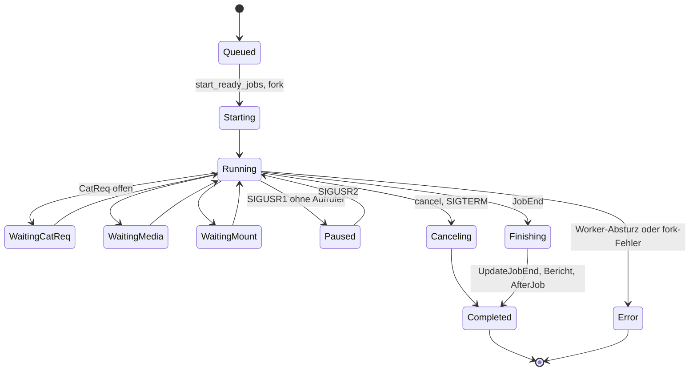

### FD/SD-Protokoll und Katalogwünsche (catreq)

- **C++:** `fd_cmds.cc` (`ConnectToFileDaemon`, `SendIncludeExcludeLists` …), `sd_cmds.cc`,
  `msgchan.cc` (`StartStorageDaemonJob`, `msg_thread`), `getmsg.cc` (`BgetDirmsg` verteilt
  `C`atalog, `U`pdCat, `B`lastAttr), `catreq.cc` (`CatalogRequest` Zeile 117,
  `CatalogUpdate` Zeile 687), `next_vol.cc`, `newvol.cc`, `recycle.cc`, `autoprune.cc`.
- **Rust:** `fd_protocol.rs`, `sd_protocol.rs` (dünne Hülle um `bareos-stored`),
  `backup_worker.rs`, `sd_copy.rs`, `catreq.rs` (Port von `catreq.cc`, der Verteilung aus
  `getmsg.cc` und den aufgerufenen Teilen von `next_vol.cc`, `recycle.cc`, `newvol.cc` und
  `cats/`; Nachrichten werden mit einem Port von `bsscanf`, `lib/scan.cc`, zerlegt, C-055).
  Volume-Auswahl inkl. PruneVolumes, Purge/Recycle Oldest Volume ist nachgezogen (S-27, S-28);
  LabelFormat mit Variablen nennt der Modulkommentar von `catreq.rs` noch als nicht portiert,
  `expand.rs` ist dafür vorgesehen.

---

## 5. Katalog

### Zugriffsschichten

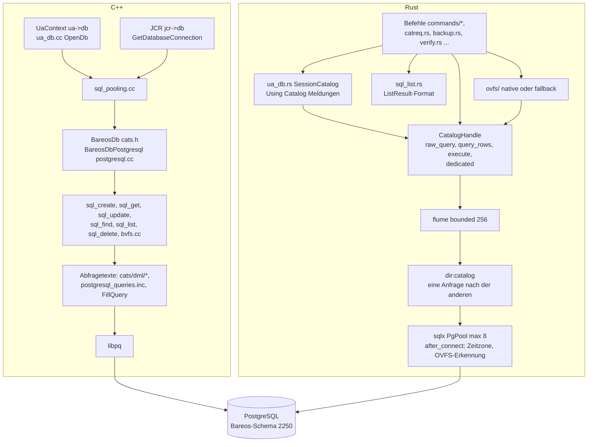

| Thema | C++ | Rust |
|---|---|---|
| SQL-Herkunft | zentrale Abfragetexte (`cats/dml/*`, 112 Dateien; `postgresql_queries.inc`) und Funktionen in `sql_*.cc` | SQL-Texte in den Handlern selbst (`catreq.rs`, `commands/*.rs`), als Nachbau der C++-Funktionen; eine eingebundene Datei (`commands/subscription_with.sql`) |
| Verbindungen | je JCR/Konsole eine (gepoolte) Verbindung, parallel nutzbar | ein Katalog-Thread, Anfragen seriell (siehe oben) |
| Ergebnisdarstellung | `BareosDb::ListResult` (`cats/sql.cc`) | `sql_list.rs` (NULL wie `PQgetvalue` als leerer Text, Breite 4) |
| Schema | DDL `cats/ddl`, Upgrade per Skript `update_bareos_tables`; `CheckCatalog` prüft die Version | `bareos-orm`: JSON-Schemabeschreibung (`schema/v2250_bareos_catalog.json`, Drift-Test gegen Original-DDL `tests/upstream_ddl.rs`, C-052) und **automatische Migration beim Start** (`main.rs` → `Migrator::migrate`), wenn das Schemaverzeichnis existiert; v2251/v2252 legen Onesimus-Views und -Funktionen an (`vw_job_summary`, `sp_create_job_record` …) |
| Schutz | — | `bareos-orm` überspringt zerstörende Anweisungen und prüft Sequenzen (C-039) |
| Basisdatensätze beim Start | `CheckCatalog` (`dird/check_catalog.cc`) | `check_catalog.rs::ensure_basic_records` (nur Client/Storage/MediaType; Pools über C-066) |

### Zeitbehandlung (C-082)

Das Original schreibt Job-Zeiten als **lokale Zeit im Text** (`bstrutime`, `lib/btime.cc`,
`cats/sql_update.cc`); libpq-Sitzungen laufen in der Server-Zeitzone. Onesimus schrieb
anfangs `to_timestamp(epoch)` über Stored Procedures und sqlx startete jede Sitzung mit
`TimeZone=UTC`. Behoben: Text wie `bstrutime()` (`job_messages.rs::bstrutime`, genutzt in
`job_manager.rs`, `migrate.rs`, `vbackup.rs`, `catalog_worker.rs`), und
`catalog_worker.rs::server_time_zone` setzt nach dem Verbindungsaufbau die Zone wie libpq
(PGTZ, sonst Rolle/Datenbank, sonst `log_timezone`). Zeitangaben auf der Konsole parst
`btime.rs::str_to_utime` mit der `bsscanf`-Semantik des Originals (C-059).

### OVFS gegen BVFS

| | BVFS (C++ und Rust) | OVFS (nur Onesimus) |
|---|---|---|
| Ort | `cats/bvfs.cc`; in Rust byte-gleich portiert in `commands/bvfs.rs` (C-022) | PostgreSQL-Extension `ovfs` (eigenes Repository) mit Rückfall im Director (`ovfs/`) |
| Arbeitsweise | Cache-Tabellen `PathHierarchy`, `PathVisibility`, Befehle `.bvfs_*` mit eigener Verbindung (`BEGIN/LOCK`) | `ovfs.tree`, `ovfs.ls`, `ovfs.jobids_latest`, `ovfs.versions`; ohne Extension rechnet `ovfs/fallback.rs` + `tree.rs` dasselbe aus den Katalogzeilen per Server-Cursor |
| Erkennung | — | `catalog_worker.rs::detect_ovfs` bei jedem Verbindungsaufbau (`ovfs/capability.rs`) |
| Schnittstelle | `.bvfs_*` (WebUI) | `.ovfs_status/_latest/_tree/_ls/_versions`, MCP-Tools |
| Status | bleibt für Bareos-Clients unverändert erhalten | Onesimus-Weg für Verzeichnisbäume; Äquivalenztest `ovfs/tests.rs` |

---

## 6. Meldungen und Logging

| | C++ | Rust |
|---|---|---|
| Job-Meldung | `Jmsg` (`lib/message.cc:1186`) formatiert und ruft `DispatchMessage` (Zeile 613) | Texte in `job_messages.rs` (Original-Wortlaut), Kopf `<dir> JobId <n>: ` in `console_msg::job_message_text`, Verteilung `console_msg::dispatch_job_message` → `audit::dispatch` |
| Aus dem Worker | — (gleicher Prozess) | `PipeMessage::Jmsg` an den Director (`job_worker.rs`, eine Zeile je `write` unter `JMSG_PIPE`-Lock) |
| Warteschlange | `Qmsg` (Zeile 1396) in `jcr->msg_queue`, ausgegeben von `DequeueMessages` (Zeile 1429) beim nächsten `Jmsg` | nachgebaut für Watchdog-Meldungen (Nachtrag C-083, S-26) |
| Ziele | Messages-Ressource: `console`, `file`, `append`, `catalog`, `director`, `mail`, `mailonerror`, `mailonsuccess`, `operator`, `syslog`, `stdout`, `stderr` | `audit.rs::dispatch` bedient `console`, `file`, `append`, `catalog`. **Mail, Operator, Syslog und die Standardströme werden nicht bedient** (Kommentar an `dispatch`) |
| Konsolen-Warteschlange | `InitConsoleMsg`, Datei `<WorkingDirectory>/<name>.conmsg` (`lib/message.cc`) | `console_msg.rs` mit derselben Datei und denselben Regeln |
| Katalog-Log | `SetDbLogInsertCallback(DirDbLogInsert)` (`dird.cc`) | `job_messages::set_catalog`, `log_insert` |
| Audit | `dird/ua_audit.cc` | `audit.rs` (C-037) |
| Daemon-Log/Debug | `Dmsg`, `debug_level`, Trace-Datei | `tracing` + `tracing-subscriber`; `logging.rs` lädt den Filter bei `setdebug` neu |
| Ereignisse an Clients | — | `message_bus.rs` (crossbeam), Push-Ereignisse über gRPC (`grpc/push_events.rs`) |

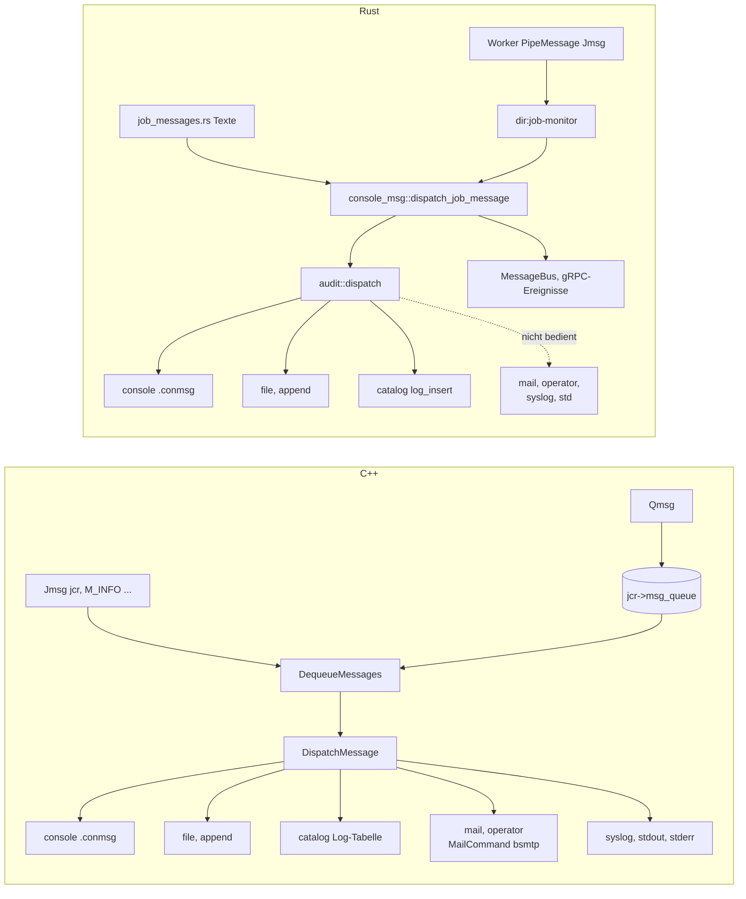

Die fehlende Mail-Zustellung ist in [STUBS.md](../STUBS.md) und [BACKLOG.md](../BACKLOG.md)
nicht als offener Punkt geführt (Suche nach „mail“ ohne Treffer). Für Installationen, die
Job-Berichte per `MailCommand` verschicken, ist das eine stille Funktionslücke.

---

## 7. Scheduler, Watchdog, Limits

| | C++ | Rust |
|---|---|---|
| Scheduler | `Scheduler::Run` im Hauptthread (`scheduler.cc`, `scheduler_private.cc`, `scheduler_job_item_queue.cc`): Warteschlange der laufenden und nächsten Stunde, Doppelschutz über `scheduled_last` (61 s) | `scheduler.rs` (gleiche Regeln, S-02) im Thread `dir:scheduler`, Start über `scheduled_run.rs` → `commands::job::start_job` (C-081) |
| Verzögerter Start | Thread `sched_wait` je Job (`jobq.cc:161`) | Warteliste im `JobManager` (Status `t`), kein eigener Thread |
| Watchdog | `lib/watchdog.cc`: ein Thread, registrierte Timer (`RegisterWatchdog`), u. a. `JobMonitorWatchdog` (60 s) und Socket-Timer | `dir:watchdog` (`watchdog.rs`, Intervall 30 s): räumt verwaiste Zombie-Worker gezielt per `waitpid(pid)` ab, meldet einen Scheduler-Herzschlag älter als 120 s; Socket-Timeouts je Verbindung |
| Joblimits | `job_thread` (Max Start Delay, MaxRunSchedTime), `JobMonitorWatchdog` (Max Wait Time, Max Run Time, Level-Max-Runtime) | `job_manager/limits.rs` (S-22, C-083), 60-s-Takt aus `monitor_loop`; Abbruch über `commands::cancel::cancel_from_watchdog` außerhalb der Sperre |
| Onesimus-Standard | Job wartet ohne `Max Wait Time` unbegrenzt auf ein Volume | `DEFAULT_MEDIA_WAIT` = 600 s nur für blockiertes Warten auf Medien (C-085, Entscheidung) |
| Reschedule | `RescheduleJob` (`jobq.cc:567`) | `take_reruns` → `scheduled_run::rerun` (S-26) |
| Run On Incoming Connect Interval | `dird/run_on_incoming_connect_interval.cc` | nicht implementiert (Hinweis C-059) |

Der Modulkommentar von `watchdog.rs` sagt noch, die Joblimits seien „not implemented yet“;
das ist durch `job_manager/limits.rs` überholt.

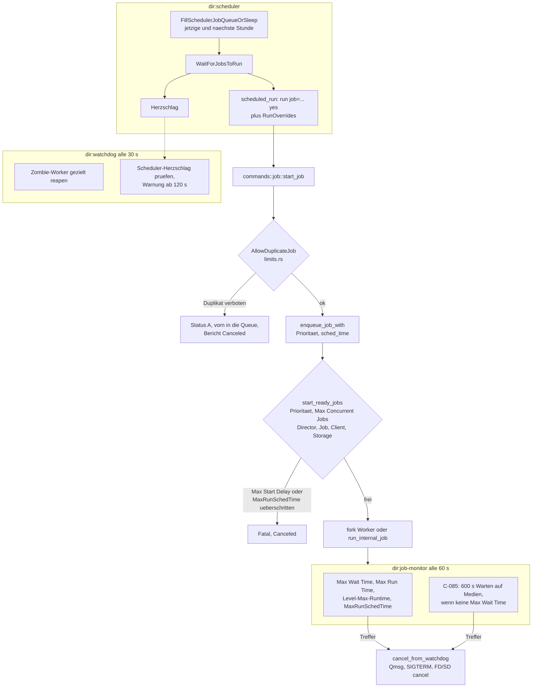

---

## 8. Sicherheitsmodell

| Thema | C++ | Rust | Bemerkung |
|---|---|---|---|
| Konsolen-ACLs | `UaContext::AclAccessOk` (`dird/ua_acl.cc:40`, `:139`), Profile, POSIX-Regex, `AclHasRestrictions` | `acl.rs` (`allowed`, `access`, `has_restrictions`, `access_audited`); Befehls-ACL vor dem Handler in `resolve_permitted` | Tests in `acl.rs` u. a. „forbidden dispatch never invokes handler through prefix or alias“ |
| ACL in Listen | `SetAclFilter`, Filter in `ua_dotcmds.cc`, `ua_output.cc` | nachgezogen (C-025, C-026) | |
| `show` und Geheimnisse | `DumpResource`/`IsResAllowed`, `hide_sensitive_data` | gleich (C-062): Filter nach ACL, Passwörter als `****************` ohne `configure`-Recht | vorher sah eine eingeschränkte Konsole alle Hashes (Sicherheitsfund) |
| Onesimus-Erweiterungen | — | `configure update/delete` prüfen die Ressourcen-ACL noch nicht (offen, Hinweis C-062); `.sqlcount/.sqltables/.sqlschema` mit derselben ACL wie `.sql` (C-074) | |
| Transport | TLS-PSK aus dem Passwort, optional Zertifikate (`tls_conf.cc`), kTLS (`SetEnableKtls`) | TLS-PSK (OpenSSL), Zertifikat-TLS nur per CLI ohne Peer-Prüfung; gRPC mit rustls und Zertifikats-Pinning beim Client | |
| Authentisierung | CRAM-MD5 zweiseitig; PAM für Konsolen (`dird/auth_pam.cc`, `AuthenticatePamUser`) | CRAM-MD5 zweiseitig; **kein PAM** (nur die Konfigurationsprüfung für PAM-Konsolen in `config_check.rs`); gRPC: HMAC-SHA256-Challenge, Sitzungstoken mit Ablauf (`session_manager.rs::authenticate_session_with_ttl`) | |
| Verbindungsgrenzen | `MaximumConsoleConnections` | nicht durchgesetzt | Angriffsfläche für Verbindungsfluten (jede Verbindung ein Thread) |
| Rechte | `-u`/`-g` (`lib/bsys` `drop`) | `privileges.rs`, vor allen Threads und vor der ersten DB-Verbindung; Fehler sind fatal | |
| MCP | — | stdio voll, HTTP nur lesend, zerstörende Tools mit `confirm: true` (C-087, [mcp.md](mcp.md)) | neue Angriffsfläche, bewusst begrenzt |
| Prozessisolation | keine (ein Adressraum) | Worker als eigener Prozess, schließt geerbte Deskriptoren 3…1023 | Deskriptoren ab 1024 würden vererbt (nicht geprüft, ob es sie gibt) |

---

## 9. Erweiterbarkeit

| | C++ | Rust |
|---|---|---|
| Director-Plugins | `dird/dir_plugins.cc` (`LoadDirPlugins` beim Start, Ereignisse wie Job-Start/-Ende), Python-Director-Plugins über `python-dir` (im Sparse-Checkout nicht enthalten) | **keine** im Director. Das Crate `bareos-plugins` (PyO3, Nachbau des `bareosdir`-Moduls) ist kein Workspace-Mitglied (`Cargo.toml`, `optional-members`) und wird von `onesimus-dird` nicht benutzt. Folge im Code: Plugin-Ereignisse entfallen, z. B. beim Prune (C-030, S-21) |
| FD-Plugins | `filed/fd_plugins.cc`, Python-FD-Plugins (`python-fd`) | eigener FD `bareos-filed` ohne Plugins (S-13 offen); der Onesimus-Director arbeitet mit dem Original-`bareos-fd` samt dessen Python-Plugins, da das Protokoll gleich bleibt |
| Plan | — | [BACKLOG](../BACKLOG.md), Addendum „Rust-only Plugin-System mit verpflichtender Zertifizierung“: nur zertifizierte Rust-Plugins, kein PyO3/Python mehr, fail-closed beim Laden. Status: Entscheidung, Umsetzung offen |
| Externe Schnittstellen | BNET + `.api 2` | zusätzlich gRPC (`Director`, `DirectorApi`), MCP, mDNS; `.help` aus der Registry |
| Konfigurierbare Befehle | `ua_cmds.cc commands[]` | `command_registry.rs` als zentrale Liste (Argumente, Vervollständigung in oconsole, Hilfe) |

---

## 10. Unterschiede, Entscheidungen, Lücken, Stärken und Risiken

### Abbildung der Module

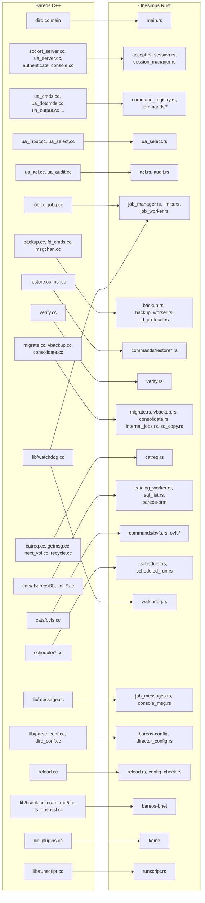

### Unterschiedstabelle

| Konzept | C++ | Rust | Folge |
|---|---|---|---|
| Job-Ausführung | Thread je Job (`jobq_server`) | Prozess je Job (`fork`), Director-eigene Jobs im Director | Absturz eines Jobs reißt den Director nicht mit; Zustand über Pipes, zusätzliche Latenz bei CatReq |
| Jobzustand | eine JCR im Speicher | `DirJob`/`JcrState` im Director + Worker-FSM | zwei Wahrheiten, Abgleich über `PipeMessage` |
| Katalogzugriff | parallel, eine Verbindung je JCR/Konsole | seriell über `dir:catalog` (außer `Dedicated`) | einfache Konsistenz, aber Durchsatzgrenze bei vielen gleichzeitigen Jobs/Konsolen (nicht gemessen) |
| SQL-Quelle | `cats/dml`, `sql_*.cc` | SQL in den Handlern | Abfragen müssen bei Upstream-Änderungen einzeln nachgezogen werden |
| Schema | Skripte, Versionsprüfung | Auto-Migration beim Start + Onesimus-Views/-Funktionen | gemeinsamer Katalog mit `bareos-dir` erhält Zusatzobjekte |
| Konfiguration | ein Modell (`ResourceItem`) | typisiert + Rohsicht + `show_items.rs` | drei Stellen pflegen |
| Reload | `LockJobs`, alte Konfig bleibt für laufende Jobs | `RwLock`-Tausch; Worker mit Kopie | kein Job-Stopp beim Reload |
| Start ohne Konfiguration | Abbruch | Minimal-Konfig mit Passwort `default` | siehe Risiken |
| Konsolen | Thread-Pool mit Grenze | Thread je Verbindung ohne Grenze | siehe Risiken |
| gRPC/MCP | keine | `dir:grpc` + `dir:cmdworker` (seriell), oconsole MCP | neue Schnittstellen, aber auf der Konsolenlogik aufgesetzt |
| Meldungsziele | alle inkl. Mail/Syslog | console, file, append, catalog | Mail-Berichte fehlen |
| PAM | ja | nein | PAM-Konsolen nicht nutzbar |
| Plugins | Director- und FD-Plugins | keine im Director | Plugin-Ereignisse entfallen |
| NDMP | ja | nein (Meldung wie Build ohne NDMP) | NDMP-Umgebungen nicht abgedeckt |
| SD-SD-Replikation | ja | nein (nur lokales Replizieren) | Copy/Migrate zwischen zwei SDs endet fatal |
| Statistik-Thread | ja | nein | `Statistics Collect …` ohne Wirkung (nicht geprüft) |

### Bewusste Onesimus-Entscheidungen

| Nr. | Entscheidung |
|---|---|
| C-009 | Versions-/Binary-Info im Bareos-Format, eigenes Versionstoken `25.1.2+onesimus.<gui>` |
| C-074 | `.sqlcount`, `.sqltables`, `.sqlschema` bleiben als dokumentierte Erweiterungen (gleiche ACL wie `.sql`) |
| C-085 | Standard-Wartezeit 600 s auf ein Volume ohne konfigurierte Max Wait Time |
| C-087 | MCP über stdio mit vollem Befehlssatz, über HTTP nur lesend; Werkzeuge nutzen die typisierte `DirectorApi` |
| S-34/S-35 | Typisierte gRPC-API; Schreib-RPCs nur im Entwicklungs-Build |
| OVFS | eigener Weg für Verzeichnisbäume, BVFS nur zur Abwärtskompatibilität (Kompatibilitätslog, Abschnitt „Weiterhin gültig“) |
| Plugins | künftig nur zertifizierte Rust-Plugins ([BACKLOG](../BACKLOG.md), Addendum) |
| Architektur | Fork je Job, tokio nur für gRPC/Katalog (Modulkommentar `main.rs`) |

### Bekannte Lücken

Offene Stubs laut [STUBS.md](../STUBS.md) und Fokus laut [BACKLOG.md](../BACKLOG.md) (17.10.2026):

| ID | Lücke |
|---|---|
| S-37 | `.profile create/set/delete/assign/unassign` ohne Wirkung (`.profile` ist Alias von `.acl`) |
| S-38 | gRPC `ConfigureUpdate`, `ConfigureDelete`, `DeleteStorage` bauen Zeilen, die die eigenen Befehle ablehnen |
| S-39 | `SetBandwidth limit=0` in proto3 nicht übertragbar |
| S-40 | `update jobid=…` auf nie gestarteten Job: SQL-Fehler |
| S-41 | `list nextvolume` findet frisch gelabeltes Volume nicht (gegen Original prüfen) |
| S-13 | Rust-FD ohne PKI, Plugins, Heartbeat, client-initiierte Verbindungen, LMDB-Accurate, Windows/macOS |
| C-014 | SD-Teil von `status all`/`status storage` |
| C-057 | Normaler Start prüft nicht wie `-t`; keine Lexer-Diagnosen |
| C-062 | `configure update/delete` ohne Ressourcen-ACL |
| C-056 | `max_bandwidth` laufender Jobs |
| C-084/S-08 | `label … encrypt` ohne Volume-Schlüssel |
| C-047 | Nicht-UTF-8-Dateinamen auf SQL_ASCII-Katalogen |
| C-059 | `update jobid=… starttime=`, Run On Incoming Connect Interval |
| C-058 | Cancel-Berichtszeilen, `*JobCancel*`-Nummer, passive Clients beim Backup ungeprüft |

Zusätzlich bei dieser Durchsicht gefunden und in keinem der beiden Dokumente geführt (bitte
prüfen, ob sie aufgenommen werden sollen):

- Meldungsziele `mail`, `mailonerror`, `mailonsuccess`, `operator`, `syslog`, `stdout`,
  `stderr` werden nicht bedient (`audit.rs::dispatch`).
- `MaximumConsoleConnections` wird nicht durchgesetzt.
- PAM-Anmeldung für Konsolen fehlt.
- Client-initiierte FD-Verbindungen (`Connection From Client To Director`) werden nur
  registriert.
- Start ohne Konfigurationsdatei mit eingebauter Minimal-Konfiguration (`main.rs`).
- Kein Statistik-Thread, keine Statusdatei (`WriteStateFile`).
- Modulkommentar `watchdog.rs` zu den Joblimits ist veraltet.

### Stärken und Risiken

**Bareos (C++)**

| Stärken | Risiken |
|---|---|
| Ausgereift, 20 Jahre Betrieb, vollständiger Funktionsumfang (NDMP, Plugins, PAM, Mail) | Ein Adressraum: ein Speicherfehler in einem Job oder Plugin beendet alle Jobs |
| Echte Parallelität bei Jobs und Katalogzugriffen (eigene Verbindung je JCR) | Manuelle Speicherverwaltung, viele globale Zustände und Sperren (`LockJobs`, `ResLocker`, JCR-Kette) |
| Zentrale SQL-Quellen (`cats/dml`) | Erweiterung nur über BNET-Text/`.api 2` oder Plugins in C/Python |
| Reload hält alte Konfiguration für laufende Jobs am Leben | Scheduler im Hauptthread: blockiert er, steht die Planung (kein externer Herzschlag) |

**Onesimus (Rust)**

| Stärken | Risiken |
|---|---|
| Prozessisolation je Job: Absturz, Speicherleck oder Hänger eines Jobs bleibt im Worker; Abbruch per Signal | `fork` in einem Mehrthread-Prozess: im Kind existiert nur der forkende Thread; Sperren anderer Threads (Allokator, `tracing`, statische `Mutex`e) können gesperrt geerbt werden. Abgefangen ist das Logging-Reload-Lock (`logging::guard_reload_for_fork`); andere Sperren nicht geprüft |
| Speichersicherheit, `unsafe` nur an Systemgrenzen | Ein `Mutex` für den gesamten `JobManager`, Katalog seriell über einen Thread, gRPC seriell über `dir:cmdworker`: Engpässe bei vielen Jobs/Clients (nicht gemessen) |
| Byte-genaue Parität über einen Paritäts-Harness (`tests/parity`, Baseline 2164 Fälle) | Große Kompatibilitätsfläche: jede Ausgabezeile, jeder Dialog, jedes SQL wird nachgebaut; Upstream-Änderungen müssen einzeln nachgezogen werden |
| Benannte Threads (`dir:*`, `job:<id>`) erleichtern Diagnose mit `ps`/`top` | Doppelte Konfigurationsmodelle (typisiert, roh, `show_items.rs`) |
| Typisierte gRPC-API und MCP auf derselben Befehlslogik, ACL-geprüft | gRPC-Antworten hängen an der API-2-JSON-Ausgabe (Formatänderung → Feldverlust, nur als Debug-Log `unmapped`) |
| Konsolen-Hilfe aus dem Original generiert (`ua_commands_table.rs`), Registry als zentrale Liste | Fehlende Grenzen (Konsolenverbindungen), Start ohne Konfiguration mit Standardpasswort |
| Katalog-Schema mit Drift-Test gegen Original-DDL | Auto-Migration und Onesimus-Objekte im gemeinsam genutzten Katalog; Worker-Polling mit 100 µs Schlaf kostet CPU bei langen Jobs |

### Offene Fragen

- Durchsatz bei vielen gleichzeitigen Jobs: Wie verhalten sich der serielle Katalog-Thread
  und das `JobManager`-Lock gegenüber dem C++-Modell? Ein Lastvergleich fehlt.
- Wirkt ein Reload, der eine von einem laufenden Job genutzte Ressource entfernt, anders als
  im Original?
- Sollen die oben gefundenen, nicht geführten Lücken in [STUBS.md](../STUBS.md) aufgenommen
  werden?
