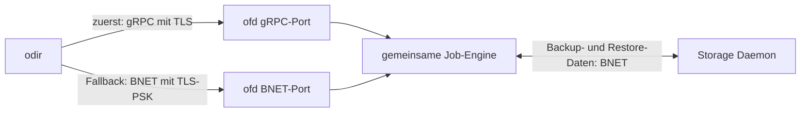

# Onesimus File Daemon

`ofd` steuert Backup, Restore, Estimate und Verify. Die Verbindung zum
Director kann über gRPC laufen. Die Datenverbindung zum Storage Daemon bleibt
BNET. Die vorhandene BNET-Steuerverbindung bleibt **immer als Fallback** erhalten.

## Verbindung und Fallback



Für einen Client mit `Grpc Enable = yes` versucht der Director zuerst gRPC.
Scheitern Verbindung, Zertifikatsprüfung, Service-Aufruf oder gegenseitige
Anmeldung, protokolliert er die Ursache und versucht den bisherigen BNET-Pfad.
Auch alte Bareos File Daemons bleiben so erreichbar. Ohne die Option wird direkt
BNET verwendet. `TLS Enable` und `TLS Require` gelten weiterhin für den
BNET-Fallback; gRPC verwendet immer TLS mit Zertifikatsprüfung.

Der Fallback erfolgt **beim Verbindungsaufbau**. Ein bereits laufender Job wird
nach einem Verbindungsabbruch nicht über einen zweiten Transport wiederholt;
das könnte Dateizustände und Katalogeinträge doppelt verändern. Es gelten die
bestehenden Fehler- und Wiederholungsregeln des Jobs.

gRPC überträgt protobuf-Nachrichten mit getrennten Nutzdaten und Steuersignalen.
Die bestehende gegenseitige Hello-/CRAM-Anmeldung läuft innerhalb der TLS-
geschützten Sitzung. Die gemeinsame Job-Engine erhält lokal dieselben Nachrichten
wie bisher. Auch binäre Restore-Objekte behalten ihre Nachrichtengrenzen.
Monitor-Directors dürfen weiterhin nur die dafür freigegebenen Befehle nutzen.
Der Proto-Vertrag steht in [filed_service.proto](../../proto/filed_service.proto).

## File Daemon starten

Das Serverzertifikat muss für den DNS-Namen beziehungsweise die IP-Adresse des
File Daemons gültig sein. Der Director benötigt die ausstellende CA; bei einem
selbst signierten Zertifikat kann er dieses ausdrücklich als Vertrauensanker
verwenden. Schlüsseldatei und Konfiguration müssen für den Dienstbenutzer lesbar
sein.

```bash
ofd -f -c /etc/bareos/bareos-fd.d \
  --grpc-listen 0.0.0.0:10102 \
  --grpc-cert /etc/bareos/tls/filed.crt \
  --grpc-key /etc/bareos/tls/filed.key
```

Der bestehende BNET-Port aus der Client/FileDaemon-Ressource (normalerweise
`9102`) bleibt parallel offen. Passive Storage-Verbindungen nutzen weiterhin
diesen Port. Ohne `--grpc-listen` startet nur der bisherige BNET-Listener.
Die zusätzliche Adresse wird vor dem Start gebunden; Zertifikats- oder Bindfehler
führen zu einem Startfehler.

Die `Director`-Ressource im FD enthält wie bisher Name und Passwort des
berechtigten Directors. gRPC führt kein zweites Passwortsystem ein.

## Director konfigurieren

Die zusätzlichen Direktiven gehören in die **Client-Ressource des Onesimus
Directors**, nicht in eine Konfiguration des Original-Bareos-Directors:

```text
Client {
  Name = client-fd
  Address = client.example.org
  Port = 9102
  Password = "gemeinsames-passwort"
  Grpc Enable = yes
  Grpc Port = 10102
  Grpc CA Certificate File = /etc/bareos/tls/filed-ca.crt
  Grpc Server Name = client.example.org
}
```

| Direktive | Bedeutung |
| --- | --- |
| `Grpc Enable` | gRPC zuerst versuchen; Standard aus. BNET bleibt der Rückfall. |
| `Grpc Port` | gRPC-Port; Standard BNET-Port + `1000`. |
| `Grpc CA Certificate File` | PEM-Vertrauensanker für die Prüfung des FD-Serverzertifikats. Bei fehlender oder ungültiger Datei wird auf BNET zurückgefallen. |
| `Grpc Server Name` | Erwartete Zertifikatsidentität; Standard `Address`. |

Nach Änderungen die Director-Konfiguration neu laden. Neue Verbindungen nutzen
die neue Einstellung; bestehende Verbindungen werden nicht umgeschaltet.
Status, Resolve, SetDebug, Bandbreitensteuerung, Cancel, Estimate sowie die
Backup-/Restore-/Verify-Worker verwenden denselben gRPC-Versuch mit BNET-Fallback.

## Plugins

Die neue Plugin-Architektur verwendet signierte Rust-/WebAssembly-Komponenten
mit Capability-Freigaben. Ein Plugin benötigt einen passenden, vertrauenswürdigen
Signaturnachweis für genau sein Artefakt. Python und PyO3 gehören nicht zur neuen
Schnittstelle. Ein Original-Bareos-FD mit eigenen Python-Plugins bleibt als
externer BNET-Client unabhängig davon nutzbar.

Der bisherige ungenutzte Python-Plugin-Code des Projekts wird entfernt. Der
Entwurf für Manifest, Trust Store und Host-Schnittstelle steht unter
[Plugin-Architektur](plugin-architektur.md). Die Ausführung von Komponenten wird
getrennt von der Transportumstellung umgesetzt.
