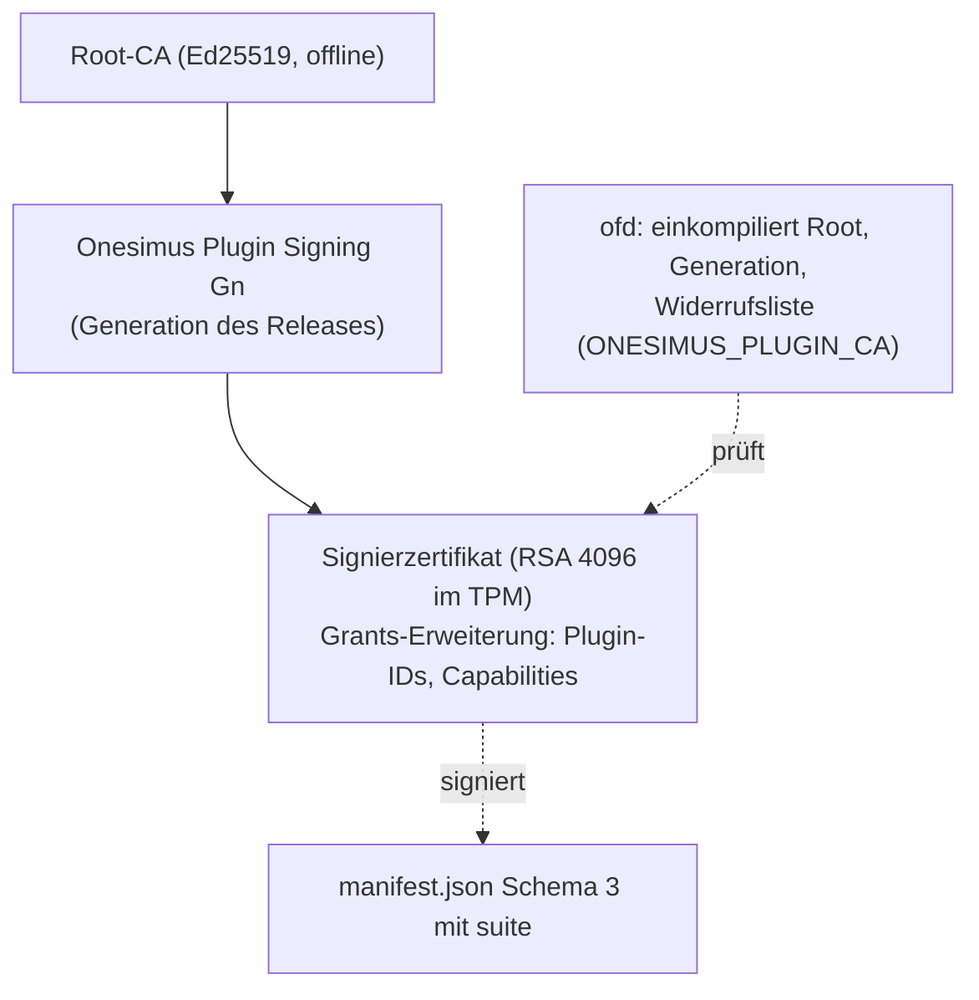
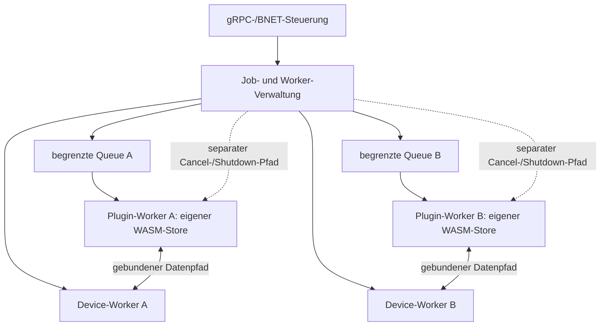
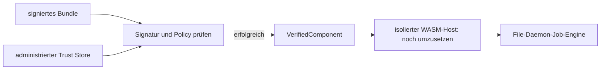

# Signierbare Plugin-Architektur

Onesimus-Plugins werden in Rust als WebAssembly-Komponenten gebaut. Es gibt kein
Python-/PyO3-Interface und keinen nativen `dlopen`-Pfad im Hostprozess. Das alte,
unbenutzte Crate `bareos-plugins` ist entfernt. Original-Bareos-Daemons dürfen
weiterhin ihre eigenen Plugins verwenden; sie sind externe Protokollpartner.

## Implementierter Stand

Das Workspace-Crate [onesimus-plugins](../../crates/onesimus-plugins/src/lib.rs)
prüft Signatur, Artefaktbindung, Vertrauensstellung (einkompilierte Root und
Generation), Grants aus dem Signierzertifikat, Widerruf, Gültigkeit,
Suite-, API- und Zielversion und Capability-Freigaben. Erfolgreiche Prüfung liefert einen
`VerifiedComponent`, der die geprüften Artefaktbytes besitzt. Der spätere Loader
muss diese Bytes verwenden, statt einen Dateipfad nach der Prüfung erneut zu
öffnen.

Der [Protobuf-Vertrag](../../proto/filed_plugin.proto) beschreibt Lebenszyklus,
Job-Ereignisse, Dateiaufzählung und blockweisen Backup-/Restore-Zugriff. Er ist
in `onesimus-proto-rs` generiert. Seit Phase 1
([Plan](../plans/PLUGIN-PHASE1.md)) führt `ofd` signierte Plugins in Jobs aus
(`crates/ofd/src/plugin.rs`): je `Plugin =`-Zeile eine Instanz mit eigenem
Wasmtime-Store, Fuel- und Speichergrenze, Abbruch über den Job. Sicherung über
`NextFile`/`ReadFile` in den SD-Strom (Bareos-Format mit `STREAM_PLUGIN_NAME`),
Wiederherstellung in Dateien ohne Plugin-Code oder online über
`WriteFile`/`CloseFile`. `FileEntry` kennt virtuelle Dateien
(`FILE_KIND_VIRTUAL`) und begrenzte Anzeige-Attribute. Ein Broker für Zugriffe
des Gasts auf Dienste des Hosts fehlt noch; er kommt mit dem ersten
produktiven Plugin ([PostgreSQL](../plans/POSTGRESQL-PLUGIN.md)). Eine gültige
Signatur allein aktiviert kein Plugin: Es muss zusätzlich in `Plugin Names`
stehen, und Policy und Bundle müssen root-eigen sein.

## X.509, Build-Signierung und Ladeprüfung

Plan und Schritt-für-Schritt-Anleitung: [Signier-Infrastruktur](../plans/SIGNIER-INFRASTRUKTUR.md).



Private Schlüssel kommen nie in ein Plugin, in `ofd` oder in `sign-component`.
Die Root-CA (Ed25519) und die Generationen liegen offline; der
Signierschlüssel (RSA 4096) wird offline erzeugt und in den TPM des
Build-Rechners importiert. Der Daemon prüft die öffentliche Kette und die
Manifest-Signatur **bei jedem Laden vor der Initialisierung**.

Ein Bundle (`SignedPluginArtifact`, [Protobuf](../../proto/filed_plugin.proto)) enthält:

- `artifact_bytes`: Rust/WebAssembly-Komponente (Component Model).
- `manifest_bytes`: exakt signierte UTF-8-Bytes, Schema-Version `3`.
- `ed25519_signature`: die abgetrennte Signatur; trotz des Namens je nach
  Schlüssel des Signierzertifikats Ed25519 (64 Byte) oder RSA-PSS (512 Byte).
- `x509_certificate_chain_der`: das Signierzertifikat, optional gefolgt von der
  Generation. Andere Zertifikate aus dem Bundle werden nie verwendet.

```json
{
  "schema_version": 3,
  "plugin_id": "io.onesimus.postgresql",
  "version": "1.0.0",
  "api_version": 1,
  "artifact_sha256": "<SHA-256 der exakten Komponenten-Bytes>",
  "signing_key_id": "<SHA-256 des DER-SubjectPublicKeyInfo des Signierzertifikats>",
  "not_before": 1795000000,
  "not_after": 1889600000,
  "capabilities": ["file.read", "postgresql.read"],
  "target": "wasm32-wasip2",
  "native": {"x86_64-linux-gnu": [{"path": "postgresql/onesimus-pg-broker", "sha256": "…"}]},
  "suite": "0.2.0"
}
```

- `suite` muss exakt dem Onesimus-Teil der Version von `ofd` entsprechen
  (`25.1.2+onesimus.0.2.0` → `0.2.0`). Schema 1 und 2 (ohne `suite`) werden
  noch eingelesen und geprüft, laden aber nicht mehr.
- `native` (optional) nennt je Debian-Triplet die Binärteile des
  Plugin-Pakets mit relativem Pfad und SHA-256. Ein Binärteil läuft nur, wenn
  sein Hash auf dem geöffneten Deskriptor zum geprüften Manifest passt.
- Hashes sind hexadezimal in Kleinbuchstaben. Die Signatur umfasst die
  gesamten gespeicherten Manifestbytes; vor der Prüfung wird nichts neu
  serialisiert. Unbekannte oder doppelte Felder werden abgewiesen.

Signiert wird in drei Schritten, ohne dass ein Onesimus-Werkzeug einen
privaten Schlüssel sieht:

```bash
cargo run -p onesimus-plugins --example sign-component -- prepare --component plugin.wasm \
    --cert signer.pem --plugin-id io.onesimus.postgresql --version 1.0.0 \
    --capability file.read --capability postgresql.read --out manifest.json
openssl dgst -sha256 -sign handle:0x81000010 -provider tpm2 -provider default \
    -sigopt rsa_padding_mode:pss -sigopt rsa_pss_saltlen:digest -out manifest.sig manifest.json
cargo run -p onesimus-plugins --example sign-component -- assemble --component plugin.wasm \
    --manifest manifest.json --signature manifest.sig --chain chain.pem --out plugin.pb
```

`assemble` prüft die Signatur vor dem Schreiben (mit `--trust-dir` zusätzlich
die volle Prüfung von `ofd`).

## Vertrauensgrenze und Prüfungen

Die **Vertrauensbasis ist einkompiliert** (`TrustBase`): `ONESIMUS_PLUGIN_CA`
nennt beim Bauen ein Verzeichnis mit `root.pem`, `generation.pem` und
`revoked.json`. Ohne die Variable hat ein Build keine Vertrauensbasis und lädt
kein Plugin; nur die Tests verwenden eine eigene Test-Hierarchie
(`onesimus-plugins`, Feature `test-ca`).

| Prüfung | Regel |
| --- | --- |
| Kette | genau Signierzertifikat → einkompilierte Generation → einkompilierte Root (byte-genau), OpenSSL mit `X509_STRICT`, Sicherheitsstufe 2; ein direkt von der Root ausgestelltes oder einer anderen Generation zugehöriges Zertifikat wird abgelehnt |
| Zweck | Signierzertifikat: kein CA, `digitalSignature`, EKU `codeSigning`; ein EKU einer CA muss Code Signing zulassen |
| Gültigkeit | aller drei Zertifikate und des Manifests zum Ladezeitpunkt (kein Zeitstempeldienst) |
| Grants | Erweiterung `2.25.166226948137511682553772901840964231856.1` des Signierzertifikats: die Plugin-ID muss genannt sein, jede angeforderte Capability ebenso |
| Signatur | nach Schlüsseltyp: Ed25519, oder RSA mit genau 4096 Bit, RSA-PSS, SHA-256, Salt = 32; PKCS#1 v1.5 und andere Längen werden abgelehnt |
| Widerruf | SPKI- und Zertifikats-Fingerabdrücke (für jedes Kettenglied) und Plugin-IDs aus der eingebauten Liste und der lokalen Policy |
| Suite, API, Ziel | `suite` exakt, `api_version` 1, Ziel `wasm32-wasip2`, Component-Header |
| Artefakt | SHA-256 der Komponente wie im Manifest |

Die **lokale Policy** (`Plugin Policy`, root-eigen) kann nur einschränken:
`plugin_ids`, `allowed_capabilities`, zusätzliche `revoked_keys`,
`revoked_certificates`, `revoked_plugins`, ein Gültigkeitsfenster
`valid_from`/`valid_until`. `ca_certificates` ist nur zum Festnageln erlaubt
(jedes Zertifikat muss einkompiliert sein); eine fremde CA, `signers` (Grants
der alten Form) oder ein anderes Ziel sind Ladefehler.

Die Prüfung kontrolliert auch den Component-Header, ersetzt aber weder die
vollständige WASM-Validierung noch die Runtime-Sandbox und deren
Ressourcenlimits; beides erzwingt der Host vor der Ausführung. Für jede neue
Initialisierung gilt der aktuelle Stand von Policy, Widerruf und Uhr; ein
`VerifiedComponent` ist kein dauerhaftes Freigabeticket. Automatischer
CRL-/OCSP-Abruf ist nicht vorgesehen.

## Zertifikatserneuerung und Schlüsselwechsel

- **Erneuerung:** Ein neues Signierzertifikat für denselben Schlüssel behält
  die Schlüssel-ID (`SHA-256(SPKI)`); die Plugins werden mit der neuen Kette
  neu vorbereitet und signiert, `ofd` bleibt unverändert.
- **Kompromittierung:** Schlüssel sofort über die lokale Policy sperren
  (`revoked_keys`), dauerhaft über `revoked.json` im nächsten Release. Ein
  neuer Schlüssel bekommt ein Zertifikat einer **neuen Generation**; das ist
  nach Entscheidung des Nutzers ein Versionswechsel der kompletten Suite
  (`ofd`, `odir`, alle Plugins). Alte Bundles laden mit dem neuen `ofd` nicht.
- Ein Widerruf nur des Zertifikats sperrt dessen Fingerabdruck; bei
  Kompromittierung ist stets der Schlüssel zu sperren. Ein selbst angegebenes
  Build-Datum ist kein Nachweis einer Signierung vor der Kompromittierung.

Technische Quellen: [OpenSSL-Kettenprüfung](https://docs.openssl.org/3.0/man3/X509_verify_cert/),
[Zertifikatszwecke und Trust Store](https://docs.openssl.org/3.0/man3/X509_STORE_CTX_new/).

## Threaded Environment: Plugins parallel zu Devices

Das Laufzeitmodell entspricht dem Thread-Modell des Directors: Der Host besitzt
getrennte Device-Worker und Plugin-Worker. Device-I/O und Plugin-Ausführung dürfen
parallel voranschreiten. Ein langsames Plugin blockiert nur seine eigene Instanz,
nicht den Steuerkanal oder alle Devices des Daemons.

- Jede aktive Plugin-Instanz bekommt einen eigenen Ausführungskontext mit eigenem
  WASM-Store, Speicher, Jobzustand, Handles und Abbruchsignal. Derselbe geprüfte
  Komponentencode darf von mehreren getrennten Instanzen gemeinsam genutzt werden.
- Der Host bindet eine Instanz an einen Job und eine logische Device-/Quell-ID.
  Mehrere Jobs oder Devices verwenden getrennte Instanzen desselben Plugins und
  können gleichzeitig laufen. Worker-IDs sind logische Kennungen des Hosts;
  Plugins erhalten dadurch keinen Zugriff auf Betriebssystem-Threads.
- Pro Instanz führt ein zuständiger Worker Aufrufe geordnet aus. Veränderliche
  Zustände werden nicht gleichzeitig aus mehreren Threads aufgerufen. Parallelität
  entsteht zwischen Instanzen und zwischen Plugin- und Device-Workern.
- Begrenzte Warteschlangen mit `max_pending_operations` verhindern unbegrenztes
  Puffern. Eine volle Instanz meldet Überlastung bzw. übt Backpressure nur auf
  ihren Produzenten aus; andere Instanzen und Device-Worker bleiben lauffähig.
- Kein globaler Plugin-/Device-Lock bleibt während Plugin-Ausführung oder
  blockierendem I/O gehalten. Registry-Locks schützen nur kurze Verwaltungszugriffe.
- Cancel und Shutdown laufen über einen separaten Steuerpfad. Sie dürfen nicht
  hinter einem hängenden Read/Write-Aufruf in derselben Queue warten. Der Host
  unterbricht WASM-Ausführung über die Mechanismen der gewählten Engine und
  bricht zugehöriges Host-I/O ab; ein Thread wird nicht unkontrolliert beendet.
- Fehler, Panic/Trap und Timeout betreffen den gebundenen Job-/Device-Kontext.
  Die Instanz wird abgewickelt, ihre Handles werden freigegeben und ihr Worker
  beendet. Andere Kontexte laufen weiter. Worker- und Instanzanzahlen begrenzt
  der Host unabhängig von den pro Instanz gewährten Ressourcen.



Die Device-Kennung bezeichnet den vom Host zugeordneten Arbeits-/Quellkontext.
Sie verschiebt keine Storage-Device-Verwaltung aus dem Storage Daemon in den FD.
Der FD↔SD-Datenstrom bleibt BNET.

Dies ist der verbindliche Ausführungsvertrag. Der Verifier allein startet keine Worker. `onesimus-plugins::executor` stellt
den Scheduler-Kern mit begrenzten Queues, direktem Interrupt und Watchdog bereit.
Der konkrete WASM-Host muss diese Interrupts mit Engine- und Broker-I/O-Abbruch
verbinden. Die grundlegenden Parallelitäts-, Queue-, Timeout- und Abbruchtests
mit einem Testadapter bestehen; Tests mit der produktiven Engine sind noch offen. Dabei müssen
Tests insbesondere belegen, dass ein blockierendes Plugin A Device B nicht
anhält, Instanzen keine Handles austauschen und Cancel trotz voller Queue greift.

## Ablauf und Schnittstelle



Die Protobuf-API definiert `Initialize`, `HandleEvent`, `NextFile`, `ReadFile`,
`WriteFile`, `CloseFile`, `Cancel` und `Shutdown`. Sie ist der sprachneutrale Vertrag für
einen späteren Host bzw. eine isolierte Host-Bridge; sie stellt keine
Berechtigung zum Starten beliebiger externer Programme dar. Die Runtime muss
Capabilities, Dateisystemzugriffe, Speicher-/Zeitlimits und Abbruch selbst
kontrollieren. Protobuf-Nachrichten und Signaturen ersetzen diese Kontrollen
nicht.

Die [gRPC-Steuerverbindung des FD](file-daemon.md) ist davon getrennt. Ihr
BNET-Fallback bleibt dauerhaft bestehen; ein abgewiesenes Plugin wird dadurch
nicht über einen anderen Ausführungsweg gestartet.
