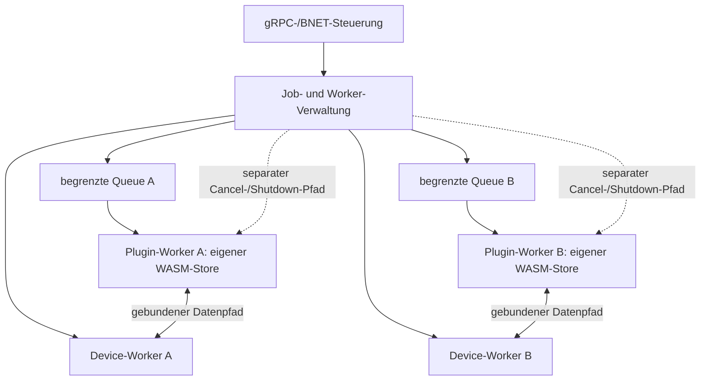
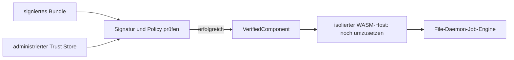

# Signierbare Plugin-Architektur

Onesimus-Plugins werden in Rust als WebAssembly-Komponenten gebaut. Es gibt kein
Python-/PyO3-Interface und keinen nativen `dlopen`-Pfad im Hostprozess. Das alte,
unbenutzte Crate `bareos-plugins` ist entfernt. Original-Bareos-Daemons dürfen
weiterhin ihre eigenen Plugins verwenden; sie sind externe Protokollpartner.

## Implementierter Stand

Das Workspace-Crate [onesimus-plugins](../../crates/onesimus-plugins/src/lib.rs)
prüft Signatur, Artefaktbindung, Vertrauensstellung, Widerruf, Gültigkeit,
API-/Zielversion und Capability-Freigaben. Erfolgreiche Prüfung liefert einen
`VerifiedComponent`, der die geprüften Artefaktbytes besitzt. Der spätere Loader
muss diese Bytes verwenden, statt einen Dateipfad nach der Prüfung erneut zu
öffnen.

Der [Protobuf-Vertrag](../../proto/filed_plugin.proto) beschreibt Lebenszyklus,
Job-Ereignisse, Dateiaufzählung und blockweisen Backup-/Restore-Zugriff. Er ist
in `onesimus-proto-rs` generiert. Die File-Daemon-Komponente führt derzeit noch
keine WASM-Plugins aus. Der Worker-Kern mit begrenzten Queues, Instanzlimits,
Job-/Device-Bindung, Deadline-Watchdog und direktem Abbruch ist implementiert und
getestet. WASM-Runtime, konkrete Host-/Broker-Implementierung, Engine-Ressourcenlimits
und Einbindung in die Job-Engine sind weitere Implementierungsschritte. Eine
gültige Signatur allein aktiviert kein Plugin.

## X.509, Build-Signierung und Ladeprüfung

Der private Signierschlüssel wird ausschließlich im Compiler-/Build-System
verwendet. Er wird weder in das Plugin eingebaut noch an den File Daemon
verteilt. Der Herausgeber stellt ein X.509-Code-Signing-Zertifikat bereit;
der Daemon prüft die öffentliche Zertifikatskette und die Artefaktsignatur
**bei jedem Laden vor der Initialisierung**.

Ein Bundle enthält:

- `plugin.wasm`: Rust/WebAssembly-Komponente (Component Model).
- `manifest.json`: exakt signierte UTF-8-Bytes, Schema-Version `1`.
- `manifest.sig`: abgetrennte Ed25519-Signatur (64 Bytes).
- Öffentliche X.509-Zertifikate als DER-Kette, Leaf zuerst, danach Intermediate-CAs.

Der [Protobuf-Umschlag](../../proto/filed_plugin.proto) transportiert diese Kette
in `x509_certificate_chain_der`. Mitgelieferte Roots werden niemals automatisch
zu Vertrauensankern. Das Zertifikatsmodell ist X.509; der Artefakt-Signaturalgorithmus
im Manifest ist Ed25519.

```json
{
  "schema_version": 1,
  "plugin_id": "org.example.files",
  "version": "1.0.0",
  "api_version": 1,
  "artifact_sha256": "<SHA-256 der exakten plugin.wasm-Bytes>",
  "signing_key_id": "<SHA-256 des DER-SubjectPublicKeyInfo des Signierschlüssels>",
  "not_before": 1792281600,
  "not_after": 1823817600,
  "capabilities": ["file.read"],
  "target": "wasm32-wasip2"
}
```

Hashes sind hexadezimal; die Schlüssel-ID ist kanonisch in Kleinbuchstaben.
Die Signatur umfasst die gesamten gespeicherten Manifestbytes einschließlich
Leerzeichen. Vor der Prüfung darf das JSON nicht erneut serialisiert werden.
`artifact_sha256` bindet die Freigabe an genau ein WASM-Artefakt. Unbekannte oder
doppelte Manifestfelder werden abgewiesen.

Beispielschritte im Build-System mit einem bereits ausgestellten öffentlichen
Zertifikat `signer.crt` und dem nur dort verfügbaren privaten Schlüssel:

```bash
# Stabile Schlüssel-ID ermitteln, ins Manifest übernehmen:
openssl x509 -in signer.crt -pubkey -noout | openssl pkey -pubin -outform DER | sha256sum
# Artefakthash ebenfalls ins Manifest übernehmen:
sha256sum plugin.wasm
# Erst das fertige Manifest signieren:
openssl pkeyutl -sign -rawin -inkey signer-private.pem -in manifest.json -out manifest.sig
# Ausschließlich öffentliche Zertifikate für das Bundle exportieren:
openssl x509 -in signer.crt -outform DER -out signer.der
```

Die Ausgabe des Beispiels enthält Hash-Platzhalter, die vor dem Signieren
ersetzt werden müssen. Zertifikatsausstellung und Aufbewahrung des privaten
Schlüssels gehören zur administrierten CA-/Build-Infrastruktur. Der Daemon
benötigt weder den privaten Leaf- noch den privaten CA-Schlüssel.

## Vertrauensgrenze und Prüfungen

`TrustPolicy` enthält ausschließlich öffentliches Vertrauen und lokale Freigaben:

| Feld | Bedeutung |
| --- | --- |
| `trust_anchors_der` | Administrierte CA-Vertrauensanker; kein automatischer Import aus Bundles oder dem Web-/TLS-Rootstore. |
| `signers` | Schlüssel-ID → erlaubte Plugin-IDs und Capabilities. Eine gültige CA-Kette allein erlaubt einem Herausgeber nicht jedes Plugin. |
| `revoked_keys` | Gesperrte SPKI-Fingerprints, für Leaf-, Intermediate- und CA-Schlüssel. |
| `revoked_certificates` | Gesperrte SHA-256-Fingerprints einzelner DER-Zertifikate. |
| `revoked_plugins` | Gesperrte Plugin-Identitäten. |
| `allowed_capabilities` | Zusätzliche lokale Obergrenze; sowohl diese als auch die Herausgeberfreigabe müssen jede angeforderte Fähigkeit erlauben. |
| `target` | Exaktes freigegebenes Ziel, z. B. `wasm32-wasip2`. |
| `valid_from`, `valid_until` | Gültigkeitsfenster des administrierten Offline-Policy-/Widerrufsstands. Abgelaufene oder fehlende Policy wird abgewiesen. |

Der Verifier prüft die Kette mit OpenSSL einschließlich Signaturen, aktueller
Zertifikatsgültigkeit, CA-/Pfadlängen-/kritischen Extension-Regeln und
Authentifizierungsniveau. Das Leaf muss ein Nicht-CA-Zertifikat mit explizitem
`digitalSignature` und `codeSigning` sein. Falls eine CA einen EKU einschränkt,
muss dieser Code Signing zulassen. Schlüssel-ID und Leaf-SPKI müssen genau
übereinstimmen. Unvollständige/unvertrauenswürdige Ketten und Widerrufe werden
vor Artefaktfreigabe abgewiesen.

Die Zertifikats-, Manifest- und Policy-Gültigkeit werden zum Prüfzeitpunkt
kontrolliert. Zeitangaben sind UTC-Unixsekunden; Manifest-/Policy-Obergrenzen
gelten exklusiv. Die Uhr und der Policy-Stand kommen vom administrierten Host,
nicht aus einer Behauptung des Plugins.

Die lokale Widerrufsliste ist implementiert. Automatischer CRL-/OCSP-Abruf,
Signierung/Verteilung von Policy-Updates und eine produktive WASM-Loader-Einbindung
sind noch offen. Der spätere Loader muss für jede neue Initialisierung den
aktuellen Trust-/Widerrufsstand anwenden; alte `VerifiedComponent`-Instanzen
sind kein dauerhaftes Freigabeticket.

Die Prüfung kontrolliert auch den Component-Header, ersetzt aber weder die
vollständige WASM-Validierung noch die Runtime-Sandbox und deren Ressourcenlimits.
Beides muss der spätere Host vor der Ausführung erzwingen.

## Zertifikatserneuerung und Schlüsselwechsel

Die dauerhafte Schlüsselidentität ist `SHA-256(DER SubjectPublicKeyInfo)`. Ein
neues Zertifikat mit demselben öffentlichen Schlüssel behält diese ID. Ein
signiertes unverändertes Artefakt kann deshalb mit einer erneuerten gültigen
öffentlichen Kette bereitgestellt werden, sofern Manifest und Hostpolicy es
weiterhin erlauben. Zertifikate, Seriennummern und Laufzeiten sind austauschbar;
private Schlüssel sind keine Laufzeitressource des Daemons.

Bei einem **kompromittierten Schlüssel**:

1. Neuen privaten Schlüssel im Build-/Signiersystem erzeugen und neues
   Code-Signing-Zertifikat ausstellen lassen.
2. Neue SPKI-ID mit den benötigten Plugin-/Capability-Freigaben administriert
   verteilen; den alten SPKI-Fingerprint widerrufen und die alte Freigabe entfernen.
3. Bekannte vertrauenswürdige Artefakte erneut prüfen, das Manifest mit neuer
   Schlüssel-ID erstellen und mit dem neuen Schlüssel signieren.
4. Das neue Bundle bereitstellen. Alte Bundles und auch neue Zertifikate über
   dem kompromittierten alten Schlüssel bleiben gesperrt.
5. Bereits laufende Instanzen nach Betriebsrichtlinie deaktivieren/ersetzen;
   eine Policyänderung beendet einen Thread nicht automatisch. Diese Verbindung
   zur Instanzverwaltung ist bei der produktiven Loader-Einbindung umzusetzen.

Ein Widerruf nur des Zertifikats betrifft dessen Fingerprint; eine reguläre
Erneuerung mit gleichem **nicht kompromittiertem** Key kann danach zulässig sein.
Bei Schlüsselkompromittierung ist deshalb stets der Key selbst zu sperren.
Zertifikatserneuerung allein widerruft das alte Zertifikat nicht. Ein selbst
angegebenes Build-Datum ist kein vertrauenswürdiger Nachweis einer Signierung
vor der Kompromittierung; ein TSA-Zeitstempelmodell ist derzeit nicht implementiert.

Technische Quellen: [OpenSSL-Kettenprüfung](https://docs.openssl.org/3.0/man3/X509_verify_cert/),
[Zertifikatszwecke und Trust Store](https://docs.openssl.org/3.0/man3/X509_STORE_CTX_new/).

## Threaded Environment: Plugins parallel zu Devices

Das Laufzeitmodell entspricht dem Thread-Modell des Directors: Der Host besitzt
getrennte Device-Worker und Plugin-Worker. Device-I/O und Plugin-Ausführung dürfen
parallel voranschreiten. Ein langsames Plugin blockiert nur seine eigene Instanz,
nicht den Steuerkanal oder alle Devices des Daemons.

- Jede aktive Plugin-Instanz bekommt einen eigenen Ausführungskontext mit eigenem
  WASM-Store, Speicher, Jobzustand, Handles und Abbruchsignal. Derselbe geprüfte
  Komponentencode darf von mehreren getrennten Instanzen gemeinsam genutzt werden.
- Der Host bindet eine Instanz an einen Job und eine logische Device-/Quell-ID.
  Mehrere Jobs oder Devices verwenden getrennte Instanzen desselben Plugins und
  können gleichzeitig laufen. Worker-IDs sind logische Kennungen des Hosts;
  Plugins erhalten dadurch keinen Zugriff auf Betriebssystem-Threads.
- Pro Instanz führt ein zuständiger Worker Aufrufe geordnet aus. Veränderliche
  Zustände werden nicht gleichzeitig aus mehreren Threads aufgerufen. Parallelität
  entsteht zwischen Instanzen und zwischen Plugin- und Device-Workern.
- Begrenzte Warteschlangen mit `max_pending_operations` verhindern unbegrenztes
  Puffern. Eine volle Instanz meldet Überlastung bzw. übt Backpressure nur auf
  ihren Produzenten aus; andere Instanzen und Device-Worker bleiben lauffähig.
- Kein globaler Plugin-/Device-Lock bleibt während Plugin-Ausführung oder
  blockierendem I/O gehalten. Registry-Locks schützen nur kurze Verwaltungszugriffe.
- Cancel und Shutdown laufen über einen separaten Steuerpfad. Sie dürfen nicht
  hinter einem hängenden Read/Write-Aufruf in derselben Queue warten. Der Host
  unterbricht WASM-Ausführung über die Mechanismen der gewählten Engine und
  bricht zugehöriges Host-I/O ab; ein Thread wird nicht unkontrolliert beendet.
- Fehler, Panic/Trap und Timeout betreffen den gebundenen Job-/Device-Kontext.
  Die Instanz wird abgewickelt, ihre Handles werden freigegeben und ihr Worker
  beendet. Andere Kontexte laufen weiter. Worker- und Instanzanzahlen begrenzt
  der Host unabhängig von den pro Instanz gewährten Ressourcen.



Die Device-Kennung bezeichnet den vom Host zugeordneten Arbeits-/Quellkontext.
Sie verschiebt keine Storage-Device-Verwaltung aus dem Storage Daemon in den FD.
Der FD↔SD-Datenstrom bleibt BNET.

Dies ist der verbindliche Ausführungsvertrag. Der Verifier allein startet keine Worker. `onesimus-plugins::executor` stellt
den Scheduler-Kern mit begrenzten Queues, direktem Interrupt und Watchdog bereit.
Der konkrete WASM-Host muss diese Interrupts mit Engine- und Broker-I/O-Abbruch
verbinden. Die grundlegenden Parallelitäts-, Queue-, Timeout- und Abbruchtests
mit einem Testadapter bestehen; Tests mit der produktiven Engine sind noch offen. Dabei müssen
Tests insbesondere belegen, dass ein blockierendes Plugin A Device B nicht
anhält, Instanzen keine Handles austauschen und Cancel trotz voller Queue greift.

## Ablauf und Schnittstelle



Die Protobuf-API definiert `Initialize`, `HandleEvent`, `NextFile`, `ReadFile`,
`WriteFile`, `CloseFile`, `Cancel` und `Shutdown`. Sie ist der sprachneutrale Vertrag für
einen späteren Host bzw. eine isolierte Host-Bridge; sie stellt keine
Berechtigung zum Starten beliebiger externer Programme dar. Die Runtime muss
Capabilities, Dateisystemzugriffe, Speicher-/Zeitlimits und Abbruch selbst
kontrollieren. Protobuf-Nachrichten und Signaturen ersetzen diese Kontrollen
nicht.

Die [gRPC-Steuerverbindung des FD](file-daemon.md) ist davon getrennt. Ihr
BNET-Fallback bleibt dauerhaft bestehen; ein abgewiesenes Plugin wird dadurch
nicht über einen anderen Ausführungsweg gestartet.
